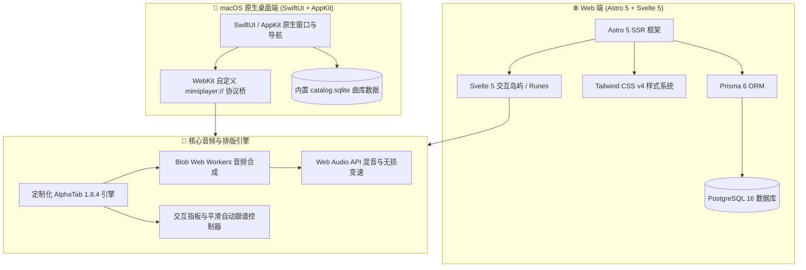

# MIMI Guitar

<p align="center">
  <strong>🎸 现代吉他与尤克里里乐谱互动演练系统 · 跨平台桌面端与 Web 体验</strong>
</p>

<p align="center">
  <a href="https://github.com/NanQiaoMi/MIMI-Guitar-Mac/releases"></a>
  <a href="#系统架构与技术选型"></a>
  <a href="#核心功能特性"></a>
  <a href="#核心功能特性"></a>
  <a href="#技术栈"></a>
  <a href="#技术栈"></a>
</p>

---

## 📖 项目概览 (Overview)

**MIMI Guitar** 是一款专为吉他、尤克里里爱好者与创作者打造的高性能互动式乐谱平台与个人演练系统。

项目最早复刻并学习自经典的在线乐谱网站「谱全了」（[guistudy.com](https://guistudy.com/)），在此基础上进行了全方位的现代化重构与架构升级：
- **设计哲学**：深度融合 Refero「General Intelligence Company」经典编辑排版风与温润纸张质感，结合 Apple / Claude 的呼吸感微动效。
- **渲染引擎**：深度定制 AlphaTab 1.8.4 高性能渲染管线与 Web Audio 音频合成架构，攻坚解决了播放指针高频抖动、重绘闪烁与跳帧问题，实现 60 FPS 连续平滑跟谱（Continuous Follow-Scroll）。
- **双端同构**：提供基于 **Astro 5 + Svelte 5 + Tailwind CSS v4** 的现代化 SSR/岛屿 Web 站点，以及基于 **SwiftUI + AppKit + WebKit + SQLite** 的原生 macOS 桌面应用程序。
- **离线与数据完全自主**：原生 macOS 版开箱内置 **16,233 首曲谱**、**8 篇深度专栏文章** 与完整 **SONiVOX GM 音源**，无需依赖 Node.js/Docker 即可秒开离线运行；网页版采用本地优先（Local-First）机制，免登录即开即练，支持符合规范的完整个人资料分卷备份迁移。

---

## ✨ 核心功能特性 (Key Features)

### 🎼 1. 全功能专业乐谱引擎 (Score & Audio Player)
- **多格式全兼容**：
  - 深度支持自研高压缩 `.ibe` 乐谱；
  - 广泛兼容主流 Guitar Pro 格式（`.gp`, `.gp3`, `.gp4`, `.gp5`, `.gpx`, `.gp8`）；
  - 支持标准 MusicXML 导入与 XHE 文本和弦谱渲染。
- **交互式吉他与尤克里里指板 (Fretboard)**：
  - 琴颈位置随乐谱实时动态点亮当前小节与音符；
  - 和弦指法多维对照图谱与即时触控试听；
  - 音符拨动粒子火花（Note Spark Trails）沉浸式动效反馈。
- **高保真音频合成与混音控制**：
  - 集成 SONiVOX 经典 GM 采样音源；
  - 独立多音轨混音器（各音轨 Volume、Solo、Mute 实时调控）；
  - 变调夹（Capo）智能移调与节拍器（Metronome）同步伴奏；
  - 50% ~ 200% 高保真无级变速播放，音高锁定不变调。
- **丝滑自动跟谱与视图控制**：
  - 针对原生 macOS 与 WebKit 优化的连续平滑滚动（Continuous Follow-Scroll），杜绝切小节时的突跳；
  - 矢量高精谱面卷轴（Vector Manuscript Roll），自适应纸张纹理与暗色/浅色排版；
  - 完整全屏演练视图，支持快捷键一键切换沉浸练习。

### ⏱️ 2. 个人智能练琴套件 (Practice Suite)
- **A-B 循环攻坚片段**：
  - 针对高难乐句自由框选 A 点与 B 点；
  - 支持保存为命名练习片段（带独立练习备注），收录进个人片段库。
- **渐进式提速训练器 (Speed Trainer)**：
  - 设定循环次数与每次递增的速度步距（例如每循环 2 次自动提速 5%）；
  - 科学肌肉记忆强化，平稳突破指法速度瓶颈。
- **练琴会话记录与续练守护**：
  - 会话时长、速度进度与完成度自动留痕；
  - 退出防误触守护（Practice Leave Guard），重新进入一键“继续上次”不断档。

### 🛠️ 3. 所见即所得制谱工坊 (Score Studio)
- **直观六线谱编曲排版**：
  - 支持键盘快捷键与虚拟指板双向快速键入品位音符；
  - 动态小节扩容、拍号与节奏设定、连音线与技巧符号支持。
- **和弦调色板与歌词抽屉**：
  - 预设常用大调/小调和弦库，一键插入与微调；
  - 双轨对齐的歌词编辑抽屉，精准锚定小节与拍位。
- **本地高可靠草稿持久化**：
  - 防丢失本地安全存储隔离区，实时自动保存草稿；
  - 支持乐谱导出与系统级 CoreGraphics 高清矢量 A4 PDF 打印。

### 📰 4. 音乐专栏与编辑风资讯 (Editorial Columns)
- **Refero 编辑风格美学排版**：
  - 现代报刊栅格、经典衬线字体排印与沉浸式阅读空间；
  - 深度支持 Markdown 富文本、多列对比表格、图文排版与教程索引。
- **曲库智能检索与难度矩阵**：
  - 支持曲名、音乐人、调性、拍号、谱型（弹唱/指弹/独奏）多维筛选；
  - 动态工艺徽章（Craft Badges）与难度仪表盘（Difficulty Matrix）量化指引。

### 🔒 5. 本地优先与数据主权 (Local-First Architecture)
- **零门槛即开即用**：全功能本地运行，无需强制注册或联网验证；
- **全量分卷备份体系**：
  - 支持生成符合规范的个人资料备份包（单个清单 JSON + 最多 128 个二进制分卷，附件总量支持至 927 MiB）；
  - 练习片段、收藏夹、待练清单、录音草稿完全归属用户，支持设备间无损迁移。

### 🍎 6. 原生 macOS 桌面深度优化 (Native Desktop App)
- **纯原生 SwiftUI + AppKit 架构**：原生窗口管理、主菜单集成、触控板惯性手势深度适配；
- **专有方案加载与无网络依赖**：
  - 采用自定义 `mimiplayer:` 协议直接读取本地资源，秒级加载；
  - 内置 16,233 首离线曲谱 SQLite 数据库与完整音源，脱机可用；
- **Universal 2 架构**：单一安装包原生支持 Apple Silicon（M1/M2/M3/M4 系列）与 Intel x86_64 双架构。

---

## 🏗️ 系统架构与技术选型 (Architecture & Tech Stack)



### 技术栈选型明细

| 模块类别 | 选型技术 | 核心功用与版本 |
| :--- | :--- | :--- |
| **Web 核心框架** | `Astro 5.18.2` | 极速服务端渲染 (SSR)、静态资源流水线与混合页面路由 |
| **交互组件层** | `Svelte 5.56.8` | 采用 Svelte 5 Runes 响应式原语，实现极致轻量零开销组件岛屿 |
| **视觉样式系统** | `Tailwind CSS 4.3.3` | 新一代 CSS 引擎，搭配 `@fontsource/fraunces` 与 `@fontsource/inter` 编辑排版字体 |
| **乐谱排版引擎** | `@coderline/alphatab 1.8.4` | 定制底座，支持 IBE / GP / MusicXML 解析与 Canvas/SVG 乐谱渲染 |
| **音频合成管线** | `Web Audio API` + `Blob Worker` | 多音轨即时合成、无损变速变调、离线音色缓存 |
| **原生 macOS 桌面** | `SwiftUI` + `AppKit` + `WebKit` | 原生双架构 macOS 13+ 桌面程序，集成专有 `mimiplayer:` 资源调度桥 |
| **离线数据存储** | `SQLite 3` (原生) / `PostgreSQL 16` (Web) | 本地 16,233 首曲库毫秒级检索，配合 Prisma 6.19.3 ORM |
| **乐谱导出打印** | `CoreGraphics` / `jsPDF 4.2.1` | 原生高精矢量 A4 乐谱导出与高清制谱打印 |

---

## 🚀 快速上手 (Getting Started)

### 方案 A：下载安装 macOS 原生桌面版（推荐）

适合希望即装即用、离线练琴演练的 Mac 用户：

1. 前往 [GitHub Releases](https://github.com/NanQiaoMi/MIMI-Guitar-Mac/releases) 下载最新的 Universal 2 安装镜像：`MIMI-Guitar-macOS-universal2.dmg`。
2. 双击打开 DMG，将 `MIMI Guitar.app` 拖入 `Applications`（应用程序）文件夹。
3. 从 Launchpad 或应用程序打开 MIMI Guitar 即可开始使用。

> [!NOTE]
> **关于 macOS Gatekeeper 安全提示**：
> 本安装包采用本地 ad-hoc 签名（未进行 Apple 商业公证）。若首次打开出现安全阻止提示，请打开 **访达 (Finder) -> 应用程序**，按住 `Control` 键单击 `MIMI Guitar.app`，在弹出菜单中点击 **“打开”** 并确认即可正常运行。无需关闭系统安全保护。

### 方案 B：本地开发与运行 Web 端

适合希望参与功能二次开发或本地启动 Web 站点的开发者：

#### 1. 环境准备
- 运行环境：**Node.js 24.x**（Apple Silicon 推荐 arm64，Intel 推荐 x64）
- 容器支持：Docker Desktop（用于运行本地开发曲库 PostgreSQL）

#### 2. 安装依赖与初始化
```bash
# 进入工程目录
cd project

# 安装锁定依赖
npm ci

# 生成 Prisma Client
npm run prisma:generate
```

#### 3. 启动本地开发服务
```bash
# 启动 Astro 本地热更新开发服务器 (默认端口 4321)
npm run dev
# 浏览器访问: http://localhost:4321
```

#### 4. 本地完整曲库恢复（可选）
若需要恢复完整包含 16,233 首曲目的本地 PostgreSQL 数据库：
```bash
# 运行 Mac 开发环境快速引导助手 (绑定 127.0.0.1:15433)
node tools/mac-bootstrap.mjs doctor
node tools/mac-bootstrap.mjs install
node tools/mac-bootstrap.mjs restore-catalog

# 以生产验证模式启动完整服务 (默认端口 4336)
node tools/mac-bootstrap.mjs start
# 浏览器访问: http://127.0.0.1:4336
```

---

## 🔨 原生 macOS 构建与打包 (Native Build)

工程已提供全自动化构建与打包脚本，支持在 macOS 主机上编译生成 Universal 2（双架构通用）应用程序及 DMG 分发镜像：

```bash
cd project

# 1. 编译乐谱渲染核心前端 Bundle (包含设置、AlphaTab 与和弦补丁)
node native-macos/tools/build_score_rendering_bundle.mjs

# 2. 生成多尺寸原生应用图标 AppIcon.icns (可选)
swift native-macos/tools/generate_app_icon.swift

# 3. 编译单架构或 Universal 2 应用程序与 DMG
# 默认输出至 outputs/Native-Mac-<版本号>/
bash native-macos/tools/build_macos_universal_app.sh --replace
```

- **编译产物**：
  - `MIMI Guitar.app`（Universal 2 可执行体）
  - `MIMI-Guitar-macOS-universal2.dmg`（只读挂载式分发镜像）
  - `BUILD-MANIFEST.txt`（包含 32,600+ 文件的 SHA-256 完整性清单）

---

## 🧪 质量验证与安全防线 (Verification & Quality Assurance)

项目实施严格的质量保障与规范生命周期：

- **自动化单测套件**：涵盖乐谱解码、数据契约、播放生命周期与练习进度持久化：
  ```bash
  npm test
  ```
- **全项目静态类型检查**：联动 TypeScript、Astro 与 Svelte Check：
  ```bash
  npm run typecheck
  ```
- **系统可用性探针**：
  - `/api/health`：快速心跳探测；
  - `/api/readiness`：数据库、音源文件与抽样乐谱就绪性健康检查。
- **凭据与敏感数据扫描**：严格杜绝任何数据库密码、密钥或个人凭据入库，生产配置强制依赖环境变量隔离。

---

## 📦 版本发布记录 (Release Notes)

### 🏷️ v0.2.4 (Current Release)
- **渲染与播放体验深度重构**：
  - 根治播放指针在切小节、暂停恢复时的微闪烁与坐标突跳；
  - 引入 60 FPS rAF 丝滑连续跟谱逻辑，降低视口推进抖动；
  - 缩减头部与播放控制栏冗余留白，提升窄屏与全屏沉浸度。
- **专栏与文章美学升级**：
  - 全新报纸排印风文章详情页，支持丰富的 Markdown 表格、引用块与代码高亮；
  - 修复多端全屏自适应与响应式断点表现。
- **通用架构交付**：
  - 发布正式版 Universal 2 DMG，完整内置 16,233 首离线曲谱与音色库。

---

## 📄 开源许可与致谢 (License & Acknowledgments)

- **核心代码库**：采用 [MIT License](LICENSE) 协议开源。
- **乐谱引擎**：感谢 [@coderline/alphatab](https://github.com/CoderLine/alphaTab) 团队提供的出色开源乐谱渲染技术底座。
- **内置音源**：集成的标准 GM 音源遵循 SONiVOX 开放许可（详见 `docs/third-party/sonivox-soundfont/`）。
- **设计启发**：视觉与交互设计启发自 [guistudy.com](https://guistudy.com/) 以及 [Refero Design](https://refero.design/) 现代设计规范。

---

<p align="center">
  Made with ❤️ for Musicians, Guitarists & Developers.
</p>
