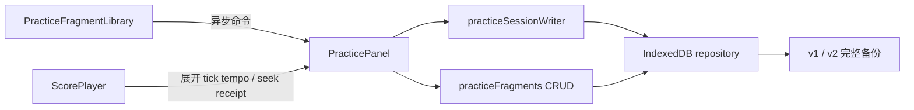

# 练习架构与命名片段迭代（2026-10-16）

## 目标与范围

稳定基线为 master `32ecd7c5`。工作分支为 `feature/practice-fragments-session-core`，使用已有隔离工作树；原 D:\MIMIguitarweb 的 1014 份源文件摘要、461 行 Git 状态已重新留存，不在原树开发。延续单设备本地保存、全量可恢复、电脑/平板/手机基础可靠的需求。本轮实现可复用的命名 A-B 片段和提速配置，同时将会话持久化/计时抽成可测试控制器。

不把单元、构建或 Chromium 模拟视口当作真机及长时间音频验收。已知的 iOS/Android/Safari、两小时运行及大容量媒体验证继续保留为未执行门槛。

## 实施顺序与写所有权

1. 三名 `gpt-6-luna / max` 子代理只读审计架构、数据与交互，主代理核实接口和版本兼容。审计已完成。
2. 数据代理负责个人类型、校验、片段 CRUD、备份合并/计数/容量、对应测试与数据设置计数；不改播放器或练习组件。
3. 架构代理负责新 `practiceSessionWriter.ts`、`PracticePanel.svelte` 的控制器提取及命令时序测试。组件保持唯一写所有者；待数据与 UI 接口冻结后再由同一代理完成片段接线。
4. UI 代理负责独立 `PracticeFragmentLibrary.svelte`，只接收数据和异步回调，支持保存/改名/备注/删除/应用，使用现有视觉与 44px 控件；不直接操作仓库或播放器。
5. 主代理负责基于 AlphaTab 已加载 tick cache 的原生 tempo 查询、播放器接线与纯函数测试、集成复核、浏览器与独立构建、文档和 Git 收口。代理完成后进行交叉复核。

## 数据与兼容契约

- 新建独立顶层 `practiceFragments`，每项有稳定 ID、scoreId、实际内容 SHA-256 revision、名称/备注、半开 A-B tick 区间、可复用的起始/目标/步进/圈数参数、A 点原生 BPM、createdAt/updatedAt 和可选 deletedAt。运行中的 BPM/已完成圈数仍只属于 session。
- 个人资料 schema 升至 2；旧 schema 1 仍可读入和恢复，先校验原始结构和 SHA 再升级。新数据必须具有片段数组。工程 StudioProject 的 schema 仍是 1；IndexedDB store 结构无需变化。
- 保留 v1 JSON 与 v2 分卷文件格式版本。两种格式都接受个人 schema 1/2，manifest 与原 data 的 schema 必须一致；旧 payload 不补字段、不改 counts、不重新定义旧摘要。仅持久化/合并的新状态升级为 2，旧应用应明确拒绝 schema 2 而非静默丢片段。
- 新片段与墓碑纳入 10,000 实体和现有 JSON 字节预算，备份计数明确展示。片段无独立二进制资产，资产引用及恢复原子事务沿用现有机制。
- 修改片段事务内重新读取谱面版本，异步过期操作拒绝。片段按 ID 与谱面版本合并；同实体更新时间决定新旧，等时删除优先；不同谱面/版本的 ID 碰撞保留确定性副本。score 冲突重映射须同步到片段。删除保留墓碑，恢复旧备份不会复活。移出待练不删除片段。

## 播放与交互契约

- ScorePlayer 已对实际下载字节计算 SHA；片段只接受该可信 revision，`unverified` 不可创建或应用。await hash 后也重新检查当前加载代次，防止切谱时旧 hash 覆盖新谱。
- 原生 BPM 按最终 A 点从展开 tick cache 的 tempoChanges 查询，覆盖冷启动、tempo map 与反复展开；缺数据或无效位置明确拒绝，不使用初始 80 或当前光标速度作猜测。
- 选 B 后以最终区间起点重新取原生 tempo，区间有效且未越谱尾才应用。应用片段前检查 scoreId、精确 revision、区间和速度倍率；校验失败不改变播放器。
- 应用先暂停并完成当前计时切片/断点，等待持久化成功；再清除旧计划、设置区间、定位 A、填充配置和起始倍率。始终保持暂停，不自动创建会话/播放/启用渐进提速；用户仍明确点击开始练习与开始提速。
- 应用/保存/改名/删除期间禁用重复提交，异步切谱时取消旧操作，不覆盖本次 session 备注；提速进度不写入可复用片段。旧 revision 片段保留，显示需重新选区，可删不可强行应用。
- 空列表、存储失败、无区间/无可信谱面/过期版本都有明确文案。原生表单、可见 label、Enter 保存、Escape 取消，错误 role=alert，状态 aria-live，无全局快捷键。

## 控制器职责与时序

无 Svelte 依赖的 writer 拥有串行写队列、上下文和代次护栏、单调计时基线、稳定 pending slice、checkpoint/close in-flight 去重。UI 保留本地草稿、会话选择与跨标签协调、播放回调和 A-B/提速状态。仓库继续负责 IDB 原子性与广播，纯领域函数继续负责终态与切片去重。

结束必须等待检查点和尾部切片、断点与 completed 提交成功后才 stop。失败保留 pending 和备注，显示可重试；旧上下文不能写进新会话，completed 不能被迟到 slice/状态覆盖。异步失败不污染新谱错误状态。

## 验证与交付门槛

- writer：排队后切谱拒写、事务内切代拒写、跨标签 completed 拒写、pending 相同 ID 重试幂等、close 等待 checkpoint 与尾片、单调时钟、失败结束不 stop 且不丢草稿。
- 数据：旧 schema 1 不带字段/count 的 v1/v2 原 SHA 恢复、新 schema 2 往返、篡改拒绝、并发改名冲突、墓碑防复活、谱面冲突重映射、容量包含墓碑、状态和资产同事务失败回滚。
- tempo：冷启动、精确速度变点、反向选区、反复展开、越界/缺失/异常值；针对安装的 AlphaTab 1.8.4 实际 cache 生成结果核对。
- 浏览器：在独立地址导入上一版真实备份，保存多片段、改名/备注、应用保持暂停、0 圈起始、删除与恢复旧备份不复活、刷新保持；双标签编辑；320/390/768/1024/1366 视口检查；导出文件独立 SHA/字段校验。失败场景至少覆盖旧版本拒绝和无效输入。
- 完整 test、typecheck、build 与适用 DB 回归必须有 exit code；既有 Svelte warning 与 bundle warning 据实记录。共享 node_modules 为原树 junction，独立干净依赖镜像构建，禁止在共享 junction 执行 npm ci。
- 最后复核原树源文件与状态零差异；代码/文档提交完整后在独立 master checkout `git merge --no-ff` 并回归。无推送、PR、部署。

## 后续验证记录

上文为实施前冻结的计划。以下是实施和验证结果；未执行的设备与长时门槛仍单列保留。

### 实现结果与职责

三名 `gpt-6-luna / max` 子代理完成架构/数据/交互审计及模块初稿；模型额度中断后由协调者接管剩余接线、修复和验收。最终增加命名片段的创建、改名、独立备注、删除、应用、版本过期状态与双标签 CAS；旧程序明确拒绝新的个人 schema 2。

关键文件：

- `src/lib/practice/practiceSessionWriter.ts`：串行队列、context + generation、单调计时边界、pending 重试与 finish 顺序；组件不再独自维护这套状态机。
- `src/lib/practice/applyPracticeFragment.ts`：输入/版本/更新时间预检，暂停保存，清除旧计划，再次读取后同步应用；切谱或并发修改即拒绝。
- `src/lib/practice/nativeTempo.ts`：从实际 AlphaTab 展开 tick cache 查原速，不依赖上一次位置事件或默认 80 BPM。
- `src/lib/practice/seekReceipt.ts`：订阅匹配的引擎 seek 事件后才确认 tick/time；处理取消、错误和超时并释放监听。
- `src/lib/personal/practiceFragments.ts`、`types.ts`、`validation.ts`、`backup.ts`、`backupVolumes.ts`、`repository.ts`：schema 2、CRUD CAS、墓碑、稳定冲突身份、旧摘要兼容与预算。
- `src/components/practice/PracticeFragmentLibrary.svelte`、`PracticePanel.svelte`、`src/components/player/ScorePlayer.svelte`、`src/components/PersonalDataSettings.svelte`：受控界面和接线、幂等暂停、迟到音频焦点申请取消、独立片段/会话备注、明确的删除计数。

实际修正的边界包括：失败检查点重试后重复计时；暂停失败重试把等待时间算入；同 context 新 generation 被旧错误清理；谱面冲突重映射让墓碑失效；冲突 ID 随备注变化漂移；下载 hash 完成后旧代次覆盖；反向跨变速选区的旧 BPM 锚点；异步 seek 只更新 tick 而 time getter 仍为旧值；320px 表单提示被 flex 压成竖排。

### 自动验证

Node 24.16.0 / npm 11.13.0。稳定基线 `npm test` 为 234/234，0 skip；本轮新增 37 项测试，最终 `npm test` 为 **271/271，0 fail、0 skip，exit 0**。

| 命令 | 实际结果 | 边界 |
| --- | --- | --- |
| `npm test` | 271 pass / 0 fail / 0 skip，exit 0 | 使用隔离 PostgreSQL 与 fake IndexedDB，不操作原资料 |
| `npm run test:db` | 10/10，exit 0 | 临时本机 `mimi_platform_test`；4 条 migration 从空库成功部署 |
| `npm run typecheck` | exit 0；TS/Astro/Svelte 0 errors | Astro 41 hints；Svelte 59 warnings / 19 files，基线为 60 warnings |
| `npm run build` | exit 0 | 独立依赖镜像生产构建；保留 AlphaTab 约 1.23 MB chunk 的既有警告 |
| `git diff --check` | 无空白错误 | 没有新增格式检查或 Lint 脚本，不冒称额外检查通过 |

新增测试文件为 `personal-practice-fragments.test.mjs`（11）、`practice-session-writer.test.mjs`（11）、`practice-fragment-apply.test.mjs`（7）、`practice-seek-receipt.test.mjs`（5）、`practice-native-tempo.test.mjs`（3）。覆盖旧 schema 原 SHA、JSON/分卷往返、墓碑与谱面重映射、稳定冲突分支、10,000 实体包含墓碑、带真实小附件的恢复 CAS/取消/原子提交、失败计时重试、perf=0、迟到写入、完成后禁写、暂停保存失败不应用、片段并发修改、引擎确认与反复 tempo map。

构建使用独立的既有 clean-dependencies 安装，避免共享 node_modules junction 把安装/构建写入原树；最终源码和构建镜像另做逐文件 SHA-256 对照。不是在原工作区执行 npm ci。

### Chromium 实际流程与文件证据

验收地址为 `127.0.0.1:4332`，以自制 12 小节双轨谱、原生 400 BPM 夹具和上一版实际导出文件测试。

| 场景 | 实际观察 |
| --- | --- |
| 旧 schema 1 v1 JSON | 168,527 bytes 的既有文件通过原摘要；空地址从 0 资料恢复 2 谱、4 会话、1 工程、2 原件/4 附件 |
| 旧 schema 1 v2 分卷 | 旧 manifest + 一卷全部通过；合并保留工程冲突副本，旧 SHA/count 没被补字段破坏 |
| 反向跨 tempo 设点 | 原 A 位于后半段 160 BPM，向前设 B 后区间为 `[4800,32264)`，保存的最终 A 原速为 120 BPM |
| 片段应用与提速 | 应用不创建会话、不播放；明确开始后 `[1,960)` 从 60 提到 65 BPM 并保持目标；应用另一片段会暂停、封存切片、保留 session 备注、清掉旧计划 |
| seek 断点一致性 | 等待引擎确认后，60 BPM/0.5× 的 A=4800 对应断点约 0:05；不再写跳转前的旧 time |
| 同源双标签编辑 | B 保存改名/备注后，A 显示冲突，旧保存按钮 disabled，并保留 A 的未提交草稿 |
| 删除后恢复删除前快照 | 旧活片段没有复活；列表只剩未删除片段，备份仍记录墓碑 |
| 同工程保存新内容 | 实际内容 SHA 变化，旧片段在播放器就绪后仍不可应用；明确提示重选区，当前版本新片段可保存/应用 |
| 输入与键盘 | 目标低于起始时保存禁用且有中文说明；Enter 可保存；Escape 清空草稿 |
| 最终真实 v1 文件 | 209,585 bytes，schema 2/revision 78，3 片段（1 删除）、6 completed 会话、2 谱、2 工程、2 原件、4 附件；Node 独立重算 canonical payload 和全部附件 SHA 均通过 |
| 最终真实 v2 文件 | manifest 89,411 bytes + volume 91,500 bytes；在全空的 `localhost:4332` 完整恢复，并实际应用当前版本片段；随后读取 revision 5、2 活片段 + 1 删除、6 会话、2 原件，旧版片段仍不可误用 |

最终 320×740、390×844、768×1024、1024×768、1366×900 五个视口在媒体查询和排版完成后均为 `clientWidth = scrollWidth`；片段区可见控件最小高度 44px，超出页面右边界控件为 0。快速切换 emulation 后的首个未排版帧不作为通过证据。最终预览处于暂停，观察到的控制台 error 为 0；临时恢复页已关闭，emulation 已复原。

证据图：

- [双标签冲突](evidence/architecture-fragments-2026-10-16/01-desktop-conflict.jpg)
- [谱面版本保护](evidence/architecture-fragments-2026-10-16/02-revision-guard.jpg)
- [320px 手机](evidence/architecture-fragments-2026-10-16/03-mobile-320.jpg)、[390px 手机](evidence/architecture-fragments-2026-10-16/04-mobile-390.jpg)
- [平板竖屏](evidence/architecture-fragments-2026-10-16/05-tablet-portrait.jpg)、[平板横屏](evidence/architecture-fragments-2026-10-16/06-tablet-landscape.jpg)
- [桌面当前片段](evidence/architecture-fragments-2026-10-16/07-desktop-current.jpg)
- [空地址恢复后的资料](evidence/architecture-fragments-2026-10-16/08-restored-data.jpg)

### 仍未执行与下一步

未执行真实 iOS/Android/iPad Safari、扬声器可闻性/系统音频中断、两小时桌面/三十分钟移动、完整 1 GiB 压力、生产媒体全量清单和生产回滚演练。因此本轮完成的是已列范围的架构与功能增量，不代表整个发布门槛全部通过。

下一轮先完成真机音频与文件恢复、长时连续练习及大容量恢复，再据实处理性能瓶颈。片段墓碑暂不自动压缩；后续若引入整理/清除，必须先设计不会被旧备份复活的协议。继续保持单设备、可完整恢复的边界，不隐式加入账号同步或公开投稿。

### Git 交付与主分支验收

工作分支为 `feature/practice-fragments-session-core`。代码、契约、测试与 8 张截图提交为 `c63d8f49`；在独立 `D:\MIMIguitarweb-master-merge` 的 master 使用 `--no-ff` 合并，代码合并提交为 `696687d4`。

合并后实际 master 上 `npx --no-install astro sync`、`npm test`、`npm run typecheck` 全部 exit 0。tests 为 271/271，0 fail、0 skip；TS/Astro/Svelte 为 0 errors，Svelte 保留 59 warnings / 19 files、Astro 41 hints。主分支 `src/tests/tools/prisma` 和配置 Git 树与已验收代码提交无差异；8 个证据链接全部存在。构建镜像对照 638 个源码/测试/配置文件，SHA-256 差异为 0。

原 `D:\MIMIguitarweb` 的 1014 个文件 SHA-256 差异为 0，461 行完整 Git 状态差异为 0；原 `feature/complete-score-studio` 未被清理或切换。本次没有推送、PR 或部署。

临时 PostgreSQL 容器按已记录的完整 container ID 核实后停止，`--rm` 已回收；精确名称查询为 0，55439 测试端口监听为 0，没有停 Docker 后台或其他容器。保留的 4332 个人练习预览 health 为 200；这不表示隔离数据库或生产曲库在线。浏览器临时恢复页关闭、视口模拟复原、预览保持暂停。

本节为主分支回归后的文档增补，另行提交与合并；代码验证对象仍是上文的代码提交和合并，文档增补不改变代码树。
