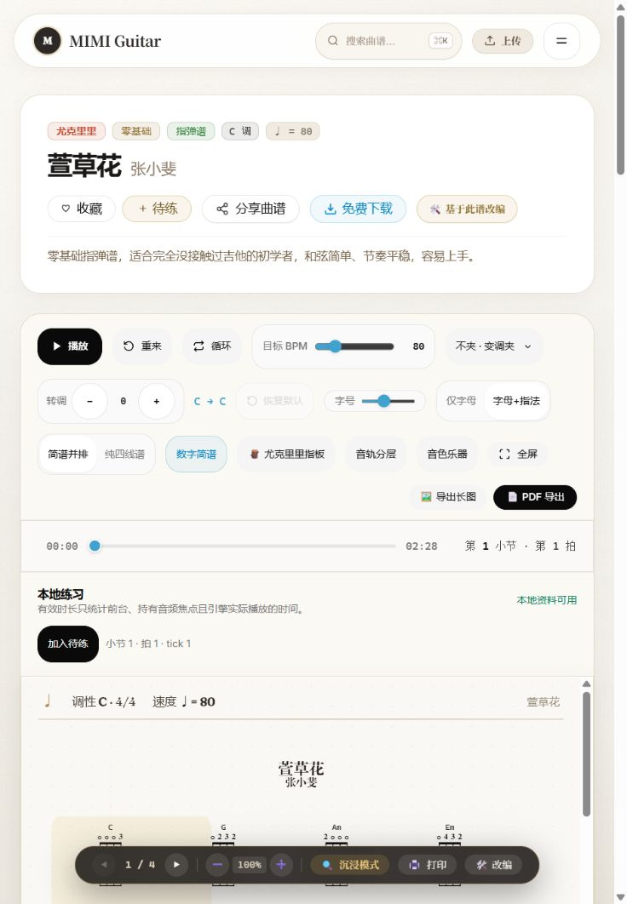

# 本地曲库运行时恢复与验收记录

记录日期：2026-10-20
保护的原目录：`feature/complete-score-studio@f4ac8ece`
实施分支：`fix/catalog-runtime-connection`，稳定基线 `master@453b0d85`
范围：Docker Desktop 本地运行时恢复、既有 PostgreSQL 容器与数据核对、曲库启动预检。本文仅记录已核实的安全事实；不包含 `.env`、凭据、原始日志、私有备份路径或备份内容。

## 故障定位与运行时目录恢复

Docker Desktop 启动日志将故障指向本机运行时 IPC 端点无法访问。只读元数据核对发现 `Docker\run` 与 `docker-secrets-engine` 下相关端点是零字节 ReparsePoint；没有读取端点内容。修复使用Docker自带的 `desktop stop --force --timeout 15` 有界停止，确认 Docker 进程退出后，同父目录非递归改名并保留旧目录。没有删除运行时目录，也没有触碰 PostgreSQL 数据卷、数据库目录或 VHD。[Docker问题库的同类报告](https://github.com/docker/desktop-feedback/issues/531)仅作为症状对照，本机恢复结论依据实际CLI和日志。

- 第一轮：原 `run` 是普通目录，内含三个已知零字节 ReparsePoint。目录改名保留为 `run.catalog-recovery-20261020`，原路径不存在且备份保留。重新启动后，日志又指向 Secrets Engine 的 `engine.sock` 端点。
- 第二轮：重新核实新 `run` 仅含一个零字节 `dockerInference` ReparsePoint；`docker-secrets-engine` 仅含一个零字节 `engine.sock` ReparsePoint。两目录分别保留改名为 `run.catalog-recovery-20261020-2` 与 `docker-secrets-engine.catalog-recovery-20261020`，原路径均不存在，备份均保留。之后再次启动 Docker Desktop。
- 恢复验证：`docker info` 返回成功（exit 0），Docker Server 版本为 `29.6.2`。

以上日志结论只概述故障类别与端点；未复制原始日志摘录。

## 既有容器与数据库核对

恢复沿用唯一的原有 `mimi-guitar-pg` 容器和原有 `mimiguitarweb_pgdata` 持久卷（卷创建于 `2026-09-28`）。容器此前为 `Exited (0)`，约两周未运行。本次只启动了原容器，没有重建容器或卷。

数据库只读核对结果：

| 业务表 | 行数 |
| --- | ---: |
| User | 30 |
| Tab | 16,233 |
| Favorite | 3 |
| UploadRecord | 10 |
| Article | 8 |

其中 `Tab` 分类为 guitar 12,212、uke 4,021；格式为 gp 12,106、xhe 4,127。当前 Prisma schema 与数据库结构 diff 为空。最后一条迁移记录原先缺失，但对应结构已经存在。

为保全与验证，另生成了私有 full custom dump，大小 `1,241,335` bytes，SHA-256：`ef91c2763e35fb358b12d01600a789056db9c7afef9a1fa92b44ddaef9f5069e`。完整 payload 已通过 `pg_restore --file=/dev/null` 解析；这验证了归档可解析，不代表执行过实际恢复演练。本文不记录备份位置或内容。

随后按 [Prisma 6已有补丁的迁移历史对齐流程](https://www.prisma.io/docs/orm/v6/prisma-migrate/workflows/patching-and-hotfixing)，仅登记缺失的 `20261015000000_tab_score_resources` 迁移记录，没有重放迁移或修改业务表。协调前后五张业务表的 digest 完全一致；迁移记录数为 4。

## 软件验证状态

- 首次 `npm test` 因新依赖的 Prisma Client 尚未生成而失败；执行 `npm run prisma:generate` 后修复。最终冻结代码的全量结果为 **446 total / 439 passed / 7 skipped / 0 failed**。7项旧数据库测试没有隔离测试库，未执行；没有对真实曲库运行会写入夹具的集成测试。
- 新增启动器的14项定向测试全部通过，包含生成的Prisma DMMF对52列的独立契约比较、缺 `Tab.timeSig`、连接身份/双栈端口、缺省超时派生与连接/事务/清理永不完成的fake。helper与CLI的 `node --check` 通过。
- 最终代码的真实 `npm run start:local -- --check` exit 0，通过完整52列检查及同一临时URL的Prisma只读探针，报告16,233条曲谱；没有启动网站或写数据库。
- 候选 `npm run build` exit 0（76.06秒）；`npm run typecheck` exit 0，0 errors、57条既有Svelte warnings（18文件）、40条Astro hints。审查后的改动仅在构建不包含的启动工具/测试，没有修改Astro应用源文件、依赖或构建配置。
- `npm run resources:check -- --source <原目录public/storage> --public <候选public/storage> --dist <候选dist/client/storage>` exit 0：32,595文件、554,546,235字节，public和dist均无缺失、额外或内容差异。这证明既有公开资源的交付一致，不能证明数据库所有引用均有文件。
- 三项审查问题已修复并验证：同目标URL只补缺失的有界超时；五个Prisma模型全部52个标量列按类型与nullable校验；所有watchdog超时统一分类并有界清理，CLI失败退出，错误不输出连接串。

## 候选4336真实运行验证

旧测试连接预览进程已停止，4336临时由独立候选构建以已核实的本机真实连接提供服务；没有改原目录的环境文件。

- health200；readiness200，database/catalog ready，四迁移完成，曲谱16233条，基础音源3/3。score和xhe各抽查20条引用，均20/20存在。
- 搜索接口 `source=catalog`，guitar总数12212、ukulele总数4021；全部分类搜索“晴天”36条。
- 三个详情接口均200、`source=database`：吉他 `1sdc49P3eKm`、尤克里里 `1wmj8hqHnYf`、文本谱 `1Oy6jj7V1`。对应原谱均HTTP200且SHA-256与构建文件相同，分别21277、7145、13038字节。详情与搜索的来源枚举不同；初次核验脚本误用搜索枚举，按既有接口契约校正后3/3通过，没有改API。
- 实际浏览器看到吉他曲库12212份、尤克里里4021份，旧演示/离线提示消失；吉他分类输入“晴天”并Enter后35条。吉他晴天详情的真实元数据为专业/指弹/69BPM，播放器就绪、播放和加入待练控件可用。尤克里里“萱草花”从列表打开，谱面渲染、播放器就绪（02:28），控件可用；文本谱“晴天”实际显示段落、歌词与和弦，仍明确限制为阅读、不开放计时练习。
- 不刷新用户原有practice标签，不清存储，不替用户开始新的练习。浏览器可见就绪状态不能代替可闻性、触屏或长时播放验证。

## 全库引用核对与已知边界

额外用只读事务读取全部Tab的公共资源引用，对候选public和dist逐个检查路径组件及文件属性；两树结果一致：

| 类型 | 引用 | 存在 | 缺失 | 不支持/未验证 |
| --- | ---: | ---: | ---: | ---: |
| scoreUrl | 12106 | 12102 | 0 | 4 |
| xheUrl | 4127 | 4127 | 0 | 0 |
| screenshotUrl | 16220 | 16220 | 0 | 0 |

四条score引用不符合本轮 `/storage/scores/` 检查范围，ID为 `1ed4dcd505e5`、`845bdfa92938`、`a144ec0da3e3`、`b9c4134b6e0c`；没有读取或输出其非标准URL，没有将其计为文件存在、缺失或播放成功。它们需要后续单独核实来源与迁移方式。结构化记录见 [resource-reference-audit.json](resource-reference-audit.json)。文件存在与已交付文件的SHA-256核验不能代替16233首曲谱逐个解码、渲染或听感验收。

## 主分支交付与最终运行

- 计划提交 `fc1bdce9`，实现提交 `5973946f`；通过候选检查后以no-ff合入本地master，代码合并提交 `bb642266`。当前实施分支 `fix/catalog-runtime-connection`，稳定工作树 `D:\MIMIguitarweb-master-merge`。随后只补充本文、计划完成项及截图，不改变应用代码。
- master `npm test`：446项，439通过、7未执行、0失败。`npm run build` exit0（71.33秒），随后 `npm run typecheck` exit0（0 errors、57既有Svelte warnings/18文件、40 Astro hints）。`git diff --check` 和启动工具语法检查通过；项目未配置独立Lint脚本，没有把未配置检查写作已运行。
- master `resources:check` exit0：32595文件、554546235字节，public和dist缺失/额外/内容差异均0。稳定树依赖已改为独立安装；没有继续依赖临时目录的node_modules junction。
- master真实 `npm run start:local -- --check` exit0，52列、四迁移、同连接只读访问通过。另在4337实际启动该入口，readiness200/16233，Ctrl+C后端口不再响应；测试实例已退出。
- 停止候选4336实例后，以master的 `HOST=127.0.0.1 PORT=4336 npm run start:local` 重新启动。最终health200，readiness200/四迁移/16233，两个分类搜索来源为catalog；三份原谱HTTP200/详情来源database，SHA-256与master构建文件一致。安全的HTTP结果见 [runtime-http.json](runtime-http.json)。
- 最终浏览器重新打开master4336的吉他列表，显示12212份曲谱，未出现演示/离线标记；保留这一交付标签。原用户practice标签及浏览器存储未改动。只保留最终4336网站与既有数据库，不遗留本轮4337或候选预览进程。

真机、触控、屏幕阅读器、声音可闻性、长时练习和系统重启后的Docker持久恢复本轮未执行；7项隔离数据库集成测试未执行。现有57条Svelte警告与4条非标准资源引用仍是已知边界。

## 工作区保护与证据边界

本轮原始 `D:\MIMIguitarweb` 工作区的1,025个文件SHA保护与402项状态快照在合并前复核均为零差异，分支仍为 `feature/complete-score-studio@f4ac8ece`。只在隔离实施树修改、提交，并在干净master树合并，没有向原目录写入环境配置、依赖或构建产物。

子代理完成实现与两轮只读复审，主代理执行真实数据库、构建、HTTP和浏览器核验。没有上传诊断包或备份，没有推送或发布；本机系统重启后的Docker持久恢复尚未验证。
