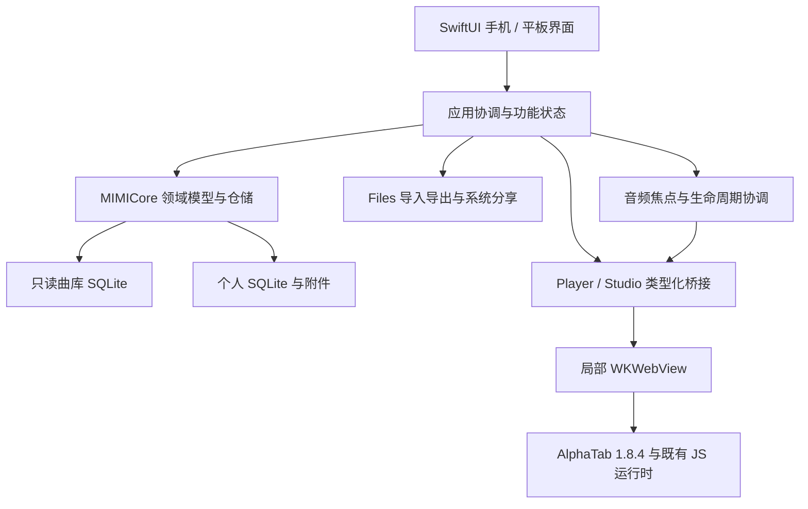

# MIMI Guitar · iOS 原生开发与 Xcode 模拟器实施计划

日期：2026-10-29。对象：当前 `project/` 中的 MIMI Guitar Web / macOS 原生工程。

本轮交付是**基于源码和本机环境核验的开发计划**。iOS 工程、构建、安装、运行及测试尚未执行。当前原生目录未发现已有 Xcode 工程，以下目录与类型名称为拟建结构。

## 1. 实施结论与完成标准

采用 **SwiftUI + UIKit 原生界面、复用 MIMICore、SQLite 本地数据、局部 WKWebView 承载 AlphaTab 谱面与现有音频引擎**。使用 Xcode 创建可以直接运行的 iPhone / iPad Universal App。

默认先在现有 Xcode 14.3.1 / iOS 16.4 模拟器完成开发闭环，部署目标暂定 iOS 16.0。使用 Swift 5.8 兼容语法、ObservableObject、NavigationStack，不把 SwiftData、Observation 宏或新系统专属视觉 API 放入基础路径。iOS 16.0 是拟定的最低支持版本，当前只安装了 16.4 runtime，不能据此声称已验证 16.0。

最终完成标准：

1. Xcode 工程可打开；指定 scheme 在 iPhone 与 iPad 模拟器构建、安装、启动成功。
2. 完成“发现曲谱 → 详情 → 听谱 → 圈选难点 → 循环 / 提速 → 保存片段 → 加入待练 → 结束与恢复”的真实操作闭环。
3. 完成工坊输入、保存重开、导入导出和备份恢复，逐项对齐[50 项功能迁移矩阵](ios-feature-migration-matrix-2026-10-29.md)。阶段样机不代替全量交付。
4. 触控布局、字号变化、横竖屏、谱面重排和连续播放指针通过专项检查；保存和恢复失败保持数据可恢复。
5. 提供 `.app`、构建日志、`.xcresult`、屏幕截图 / 操作录像、资源清单与未验证事项。模拟器产物和真机 / 上架产物分别标记。

## 2. 本机事实与工程基线

以下为本轮实际读取，证据见 [environment.json](evidence/ios-planning-2026-10-29/environment.json)。

| 项目 | 已核实状态 | 计划中的使用方式 |
|---|---|---|
| 操作系统 / 架构 | macOS 13.7.8 / x86_64 | 本机使用 Intel 模拟器构建 |
| Xcode | 14.3.1，build 14E300c | 直接使用现有工具链，不把安装 Xcode 作为前置工作 |
| Developer Directory | `/Applications/Xcode.app/Contents/Developer` | 后续构建记录实际选中的工具链 |
| Swift | 5.8.1 | 与现有 Package.swift 的 tools-version 5.8 对齐 |
| iOS SDK / runtime | iOS 16.4；runtime build 20E247 | 第一轮设备矩阵使用当前可用 runtime |
| 可用手机模拟器 | iPhone SE 3、14、14 Plus、14 Pro、14 Pro Max | 首选 iPhone 14；小屏与刘海屏分别回归 |
| 可用平板模拟器 | iPad Air 5、iPad 10、mini 6、Pro 11 / 12.9 | 先验证 iPad Air 5，再补尺寸差异 |
| 磁盘 | 查询时约 96 GiB 可用 | 分开记录 DerivedData、运行时、内容包体积 |
| 本地曲库 SQLite | `catalog` 16,233 行、`articles` 8 行，只读查询 | 可作为原生查询的数据基础；不是全部媒体可播放的验证 |
| 内容规模 | `du` 显示 Data 约 8.4 MiB、Resources 约 12 MiB、public/storage 约 592 MiB | 这是磁盘占用快照，不是 IPA 压缩体积；音源、字体等另做逐文件清单 |
| Git | `codex/p0-reliability-20261028`，存在已有未提交改动 | 只新增本计划和证据；实施前建立适当隔离，保留现有源码与资源 |

Apple 的工具链表支持 Xcode 14.3.1 与 Ventura、iOS 16.4 SDK 的对应关系；Xcode 26 的最低系统要求已提高到 macOS Sequoia 15.6。本机旧版模拟开发路径与现代发布构建路径需要分开安排。[Apple 工具链要求](https://developer.apple.com/xcode/system-requirements)

历史 Mac 迁移文档中的“没有 xcodebuild”已不符合本次现场。本计划使用以上实时结果，不继承旧环境结论；旧文件作为历史记录保留。

## 3. 复用边界与架构



| 现有文件 / 模块 | 复用方式 | 必做适配 / 验证 |
|---|---|---|
| `native-macos/Package.swift` | 用本地 Swift Package 引用 MIMICore product | 显式声明 iOS 最低版本；只把共享库加入 iOS target；不得将 Mac executable 的 AppKit 源码加入 iOS |
| `Sources/MIMICore/Catalog*.swift` | 复用曲目、文章、筛选与 SQLite 查询 | SDK / CSQLite 编译、后台查询、取消与旧请求隔离；不得在主线程做大查询 |
| `PersonalModels / PracticeModels / StudioModels.swift` | 复用数据语义、hash、版本与会话规则 | 保留时长口径、音符与弦号含义、墓碑和 revision；以跨端夹具比对 |
| `PersonalStore.swift` | 复用独立个人数据库 actor | iOS 沙盒路径注入、磁盘失败、事务冲突和强制终止后的恢复 |
| `PersonalBackup.swift / BackupCoordinator.swift` | 复用备份格式与校验逻辑 | 当前 canonical JSON 依赖 JavaScriptCore，不能随意替换为 JSONEncoder 排序；必须核对跨端摘要一致 |
| `AppPaths.swift` | 复用资源引用校验 | 用户目录现含 `com.mimi.guitar.mac`；iOS 使用独立命名空间或注入目录，禁止读写 Mac 的个人资料目录 |
| `Resources/Player` | 复用谱面、IBE、练习运行时与音色适配 | iOS WK 的资源读取、worker、音频解锁、内存和触控命中逐项实测 |
| `Resources/Studio` | 复用编谱模型、转换、撤销与渲染能力 | 原生触控工具栏、键盘避让和多轨编辑体验需要重排 |
| `NativePlayerWebView / NativeStudioWebView` | 参考消息与生命周期契约 | 从 NSViewRepresentable 改成 UIViewRepresentable；移除 NSEvent / Mac 焦点和窗口处理 |
| `PlayerResourceSchemeHandler / StudioResourceSchemeHandler` | 复用白名单、路径校验与分块读取思路 | 用 iOS 容器重新实现资源根目录与取消逻辑；验证 custom scheme 下的 JS / font / SF2 / worker 行为 |
| Mac 视图、菜单、窗口、文件面板 | 保留产品行为作为对照 | 重新制作 SwiftUI / UIKit 交互；不按固定宽度缩小桌面界面 |

App 运行路径使用随包资源和本地数据，不依赖宿主机 Node、Docker、PostgreSQL 或固定端口。Node 仅用于开发时重建已锁定版本的 JS bundle。

## 4. iPhone / iPad 产品布局

### 4.1 导航与屏幕

- **iPhone**：底部四个主入口“发现、练习、创作、我的”；发现内包含搜索、吉他 / 尤克里里范围与文章。“我的”承载个人曲库、收藏、最近浏览、数据和设置。
- **iPad**：NavigationSplitView 导航；列表与详情可并列。播放器和工坊按可用宽度决定显示检查器，分屏时折叠，禁止按设备名称写死宽度。
- 允许底部迷你播放器表达正在播放的对象，但全 App 只能有一个发声所有者。切到工坊前处理旧播放器与会话。

| 页面 | 手机布局 | 平板布局 | 验收重点 |
|---|---|---|---|
| 首页 / 搜索 | 纵向卡片、系统搜索、筛选 sheet | 列表与结果详情分栏 | 空结果、取消、分页和筛选返回后保留状态 |
| 曲目详情 | 信息、和弦、原谱预览分区；播放与待练为明确主操作 | 详情与辅助信息并列 | 不把未就绪或缺失媒体显示为可播放 |
| 播放器 | 谱面为主；播放 / 进度条固定；BPM、轨道和循环使用抽屉 | 谱面 + 可折叠混音 / 指板 | 安全区域、横屏、长谱、重排、暂停和 seek 连续性 |
| 练习 / 片段 | 队列、状态、片段列表；拖动排序同时提供按钮替代 | 队列与当前练习并列 | 进入片段停在 A 点，显式点击后才开始 |
| 工坊 | 谱面 + 底部工具架；时值、音高、奏法分组 | 轨道列表、谱面和检查器 | 点选与滚动冲突、键盘遮挡、撤销与脏状态 |
| 数据 / 备份 | 导入导出进度、预览、确认、错误与重试 | 宽屏信息布局 | 系统选择器取消不改变数据库；恢复失败不破坏原资料 |

### 4.2 手势、排版与动效

1. 阅读态以滚动为主，点选不触发误编辑；编辑态显示明确选中音符。A/B 通过当前选中位置设置，拖动边界作为增强交互。
2. 命中基于引擎真实 bounds 和有限容差；缩放后重新取坐标。密集谱面提供放大与精确选音面板，不能按平均小节宽度猜拍。
3. 普通操作控件以至少 44×44 pt 为设计目标；谱面密集音符不强行套重叠的 44 pt 热区。
4. 保留纸感、暖色与手绘点缀，正文和控件优先使用可缩放系统字体。装饰不占用谱面、说明和按钮的点击区域。
5. 标题、正文、按钮、引导线检查安全区域、内边距、重叠与截断；覆盖小屏、最大辅助字号、键盘弹出与横屏。
6. 播放指针沿引擎时间连续移动；不以一秒或一拍一次的离散更新替代。视图重建、转屏、暂停 / 恢复、变速、循环和换行均检查。
7. 跟随系统 Reduce Motion，并保留轻柔 / 静止偏好。连续播放位置仍正确表达，不通过动画偏好改变时间与会话统计。

## 5. 播放与音频的技术前置验证

这是本项目风险最高的第一道门，排在大量界面制作之前。

### 5.1 最小技术样机的退出条件

在 iPhone 14 / iOS 16.4 的真实 WKWebView 中，用自有或许可清楚的短谱完成：

- IBE / GP 至少各一份可以读取、排版、定位并播放；XHE 以其实际文字谱能力展示。
- 原生播放操作与引擎音频解锁路径可用；音源全部就绪后才能进入 playing。不能仅以 `scoreLoaded` 或按钮变色认定发声成功。
- 实测当前 custom scheme、CSP、blob worker 与引擎音频输出路径；记录错误和限制。Mac 上已经成功不等于 iOS 已成功。
- 启停、seek、BPM 修改、A/B 循环、原生音轨控件有引擎确认，画面与播放位置同步。
- 清退 WK 后无残留音频；切换曲目、首页试听和工坊不出现两个实例同时发声。

若原生按钮发起的桥接无法满足首次 Web Audio 激活条件，先验证局部谱面内明确可见的“启用播放”触控操作，不使用隐藏自动点击。若仍不可行，在 M1 输出可复现证据，再评估原生音频后端或引擎适配；不得绕过问题继续宣称整机播放路线已成立。

### 5.2 统一状态和桥接

- 状态：`idle → loadingScore → rendering → loadingAudio → ready → playing / paused → ended`，错误是可见且可重试的状态。
- 命令：load、play、pause、seek、setTempo、setLoop、setTracks、dispose。事件携带 protocolVersion、requestID、documentID、loadID 与有顺序的确认。
- 以引擎的真实 tick / 毫秒位置为权威；SwiftUI 负责显示和操作，不再建立第二套自行推算的循环 / 提速时钟。
- 曲目切换与 WK 重建使用 generation 隔离旧响应。只接收主 frame、许可来源和符合 schema 的消息；校验完成才执行命令。
- 高频位置事件合并；优先更新局部 position 对象，不让进度更新重绘整个页面或整个工坊。
- 对 dispose、导出、保存等等待设置可记录的超时和取消路径。恢复不会自动开始发声。

### 5.3 音频会话与前后台

在原生协调器中配置 AVAudioSession，默认按音乐播放场景处理；只在用户开始播放时激活。来电 / 系统音频中断、耳机断开、路由改变、前后台切换统一交给播放状态机，先暂停并保存可恢复位置。Apple 提供中断通知与相应状态信息。[AVAudioSession 中断通知](https://developer.apple.com/documentation/avfaudio/avaudiosession/interruptionnotification)

第一版默认：进入后台暂停并保存检查点，回到前台保持暂停，等待用户继续。锁屏后台持续播放、远程控制与后台音频保活列为独立增强项，需在真机证明 WebKit / 音频后端可持续运行后再承诺。系统强制终止不保证执行最后一个保存回调，因此正常练习期间也要以有界频率保存检查点。

不请求与现有功能无关的麦克风或相机权限；音高识别、录音评分不作为既有功能迁移。

## 6. 练习、工坊与数据契约

### 6.1 练习闭环

1. 片段绑定实际谱面内容 hash，记录 A/B、速度和独立备注；谱面换版后需要核对，不静默套用旧范围。
2. A/B 使用既有半开区间和引擎展开后的演奏顺序；反复、跳房子、跨小节和 seek 到边界分别验证。
3. 渐进提速只在完整圈完成后递增；暂停、手动 seek、修改循环或曲目版本时按现有契约重置 / 确认。
4. 会话记录伴奏播放时长，不标成实际练琴时长；暂停、后台、中断期间不计入有效播放。
5. 收藏、最近浏览、队列顺序、状态、归档、恢复及备注使用同一仓储，防止 UI 自己另存副本。

### 6.2 工坊

- 保留 guitar / ukulele / bass / band 模板、详情克隆、时值、附点、三连音、休止、奏法、小节、和弦、歌词、多轨和播放预览。
- 手机用分组工具架表达编辑命令；iPad 提供侧栏与外接键盘增强，但触控也能完成全部核心编辑。
- 复用真实 bounds，保留已有音符位置；撤销 / 重做、自动保存和手动保存处理同一编辑版本。
- 导入保留原件和转换提示；分别准备 GP3/4/5/GPX/GP7/8、IBE、MusicXML、AlphaTex、JSON 夹具。某一格式成功不能代表整个系列通过。
- 导出 GP 使用既有 GP7 序列化语义，不把扩展名改成旧版本后声称支持对应编码。JSON / IBE / GP / AlphaTex 做语义回读；PNG / PDF 检查实际字节、页数、缺字与裁切。
- 离开页面、切换工程与后台保存保留 dirty / revision 检查；失败时留草稿和可重试入口。

### 6.3 文件、数据库与备份

- 随包 Content 为只读，个人 SQLite、导入原件、草稿、附件、临时导出与恢复 staging 分目录存储。可清理缓存不能承载唯一原件。
- 导入通过 Files 选择器。对容器外的 security-scoped URL，按作用域访问、使用文件协调器，复制到应用 staging 后校验；结束后释放访问。iCloud 文件先确认内容可读取，取消与中断保持原数据不变。[Apple 目录访问说明](https://developer.apple.com/documentation/uikit/providing-access-to-directories)
- 单个个人导入文件维持 30 MiB 契约；先查大小、流式复制和摘要，再解析。工坊支持范围与个人曲库支持范围分别表达。
- v1 / v2 备份保持现有格式和限制：v1 64 MiB；v2 每卷负载 8 MiB、最多 128 卷、总量 1 GiB。**格式上限不是移动设备实测容量。**
- v2 清单与分卷通过原生文档导出器保存为完整一组文件；目录选择、多文件与分享行为以 iOS 16.4 API 实测为准。分享给其他 App 只能确认交接，不能声称对方已持久保存。
- 恢复顺序：选择清单 / 分卷 → 检查缺卷、顺序、大小和摘要 → 展示预览 → 用户确认 → staging → revision 检查 → 事务合并 → 回读核对。失败与取消清理本次 staging，保留旧库。
- 比对 Web、Mac、iOS 三端同一夹具的 canonical JSON、摘要、附件和关联关系；不能只验证“JSON 能打开”。
- 多窗口 / 多场景写入按 revision 保护；数据库迁移、低空间、损坏恢复与异常结束都有专项验收。

## 7. 内容、资源和联网能力

1. 技术样机使用独立自有短谱，不触碰用户个人资料。
2. 完整功能阶段接入已有 SQLite 曲库和版本化 Content 包。开发默认支持本机完整资源包；轻量夹具只用于快速回归和缺失资源场景，不冒充完整曲库。
3. 对每份谱、XHE、原谱图、字体、worker、音源生成路径 / 大小 / SHA-256 清单；构建时检查目标 `.app` 内实际文件，运行时显示明确的资源状态。
4. 在线分发 / 按需下载必须有真实资源接口、版本与摘要机制；接口未具备前不放置无效下载按钮。随包与按需方案在发行前根据体积测量确定。
5. 原生账号、文章发布等沿用真实 API 契约，并设独立联网验收；服务关闭、401、503、网络中断都显示真实状态，不用模拟验证码或假发布补齐“功能”。文章阅读与个人本地练习可独立运行。
6. 授权台账按现有声明复核：现有字体说明明确记录方正小标宋缺少随包许可证明；iOS 内容包先选用许可清楚的替代方案或补齐授权。音源、谱例和曲库媒体分别核对，不能因 Mac 曾打包就推定可对外分发。

## 8. 拟建 Xcode 目录与工程设置

```text
project/
  native-ios/
    MIMIGuitarIOS.xcodeproj/
    MIMIGuitarIOS/
      App/                  # 入口、路由、依赖与生命周期
      Features/
        Discover/           # 首页、搜索、筛选、文章
        Score/              # 详情、原谱与和弦
        Player/             # 播放器、循环、轨道、指板
        Practice/           # 队列、片段、会话、回顾
        Studio/             # 模板、谱面与触控工具架
        Library/            # 导入、本地曲库、收藏、最近
        Settings/           # 备份、账号、动效、帮助
      Platform/
        WebKit/             # UIViewRepresentable、资源 handler、桥接
        Audio/              # 音频焦点、AVAudioSession、中断
        Files/              # 文档选择、导出、分享、打印
        Storage/            # iOS 路径、内容清单与缓存
      DesignSystem/         # 颜色、字体、纸感组件、可访问性
      Resources/            # 生成或复制的 Player / Studio / Content
    MIMIGuitarIOSTests/
    MIMIGuitarIOSUITests/
    Fixtures/               # 自有谱、损坏样本、跨端备份
    tools/                  # 资源准备、构建、验证、证据采集
  native-macos/             # Mac 原实现保留；共享库从其 package 引用
```

工程设置：

- 工程 / scheme：暂定 `MIMIGuitarIOS`；包含 App、XCTest、XCUITest 三类 target。
- Deployment Target：暂定 iOS 16.0；Supported Devices：iPhone + iPad；Swift 5 语言模式。
- 本地开发 Bundle ID：暂定 `com.mimi.guitar.ios.dev`，这不是已注册标识的声明。
- 模拟器使用当前宿主支持的架构；真机保留 arm64，未来 Apple silicon 模拟器也要构建，禁止全局排除 arm64 来掩盖依赖问题。
- Xcode 直接添加本地 MIMICore package product；初期不为了目录美观大规模搬迁既有 Mac 源码。
- 本地模拟器构建设置 `CODE_SIGNING_ALLOWED=NO`；真机、TestFlight 和商店分发另走对应签名流程。
- Debug / Release 分离。仅 Debug 暴露只读诊断、引擎状态和夹具入口；Release 不保留任意 JS 执行或文件读取接口。
- 输出资源脚本有输入 / 输出清单，缺资源直接失败；不依赖开发机绝对路径或某个已运行端口。

## 9. 阶段、依赖和验收门

以下是单人连续投入的粗估人日，**不是已完成进度或固定交付日期**。M1 完成后以实际障碍校准。基础路径 M0–M7 约 20–34 人日；现代工具链、真实外部服务与真机发行验收另计。

| 阶段 | 工作与明确产物 | 前置 | 退出标准 | 粗估 |
|---|---|---|---|---|
| M0 基线与夹具 | 分离已有改动；新开发分支 / 隔离目录；50 项矩阵；资源和数据夹具 | 本计划 | 原有工作可追溯，示例不含用户私有资料；依赖版本记录完整 | 0.5–1 日 |
| M1 Xcode 技术样机 | App target、MIMICore iOS 编译、路径、WK 页面、短谱 / 音源 / 音频桥接 | M0 | iPhone 14 能真实渲染和播放；seek / BPM / 清退成功；输出可复现证据 | 1.5–3 日 |
| M2 移动界面与曲库 | 四入口、完整数据查询、筛选、文章、详情、收藏 / 最近 | M1 | 本地曲库和异常状态正确；小屏 / 平板布局可用；缺媒体明确提示 | 2–3 日 |
| M3 完整播放器 | 进度、显示模式、和弦试听、音轨、指板、A/B、节拍器、移调、全屏与谱面输出 | M1、M2 | 真实谱上的各项操作有确认；连续指针、转屏与音频中断检查通过 | 3–5 日 |
| M4 练习闭环 | 命名片段、待练、状态 / 排序 / 归档、会话、提速、续练与回顾 | M3 | 10 圈真实循环、暂停 / seek / 重开计数正确；保存失败不误报；恢复保持暂停 | 3–5 日 |
| M5 触控工坊 | 模板、克隆、输入、奏法、小节、和弦歌词、轨道、历史、草稿与播放 | M3、M4 的数据契约 | 手机触控可完成创建 → 编辑 → 保存 → 重开 → 播放，原件与转换说明保留 | 5–8 日 |
| M6 文件与备份 | 多格式导入 / 导出、系统分享 / 打印、v1/v2 恢复与跨端往返 | M4、M5 | 语义回读和摘要核对通过；取消、损坏、缺卷、低空间保持原数据 | 2–4 日 |
| M7 全量收口 | 50 项回归、iPad / 可访问性、文章 / 账号服务状态、性能和资源证据、交付说明 | M2–M6 | 无未解决 P0 / P1；逐项给出通过 / 失败 / 未执行及证据；Mac 相关共享代码完成定向回归 | 3–5 日 |

大约到 M4 才能演示完整的“找谱—听谱—片段—待练”闭环，粗估累计 10–17 人日；不把 M1 的播放器技术样机称为完整 iOS 版。

真实服务未提供的注册 / 发布等成功路径保留为“未验证 / 服务依赖”，不能为满足表格而制造成功结果。若第一阶段出现引擎路线阻塞，应先解决或重估架构，再承诺后续排期。

## 10. 模拟器、真机与检查矩阵

### 10.1 设备顺序

| 环境 | 本轮状态 | 后续验证重点 |
|---|---|---|
| iPhone 14 / iOS 16.4 | 已安装，当前 Shutdown | 每日主回归：导航、谱面、播放、文件、练习 |
| iPhone SE 3 / iOS 16.4 | 已安装，当前 Shutdown | 小屏、长文案、键盘、最大字号、底部工具架 |
| iPhone 14 Pro / iOS 16.4 | 已安装，当前 Shutdown | 刘海 / 安全区域、横屏与旋转 |
| iPad Air 5 / iOS 16.4 | 已安装，当前 Shutdown | 分栏、分屏宽度、横竖屏、工坊工具布局 |
| 现代系统模拟器 | 当前未安装 | 在兼容工具链环境补测新系统行为与 Release 构建 |
| iPhone / iPad 真机 | 本轮未检测或验证连接 | 蓝牙、音频路由、锁屏 / 中断、真实触控、内存与长时间运行 |

Intel Mac 上先顺序运行设备，避免同时开启所有模拟器。模拟器不能复现真机全部性能与硬件行为；Apple 明确要求用物理设备确认实际体验。[Apple 模拟与物理设备运行说明](https://developer.apple.com/documentation/xcode/running-your-app-on-simulated-or-physical-devices)

### 10.2 必测场景

| 类别 | 具体场景 | 判定 / 证据 |
|---|---|---|
| 构建与启动 | 干净 DerivedData 构建、首次启动、重开、Release 模拟器构建 | 实际 `.app`、退出码、控制台日志；不以工程文件存在判通过 |
| 版面 | 设备矩阵 × 横竖屏；默认 / 大字号；键盘开关；长标题 | 全屏截图，文字框、按钮、安全区域与装饰不相撞；谱面无非预期裁切 |
| 查询 | 空结果、中文 / 艺人、快速改关键词、筛选组合、分页、返回恢复 | 结果与 SQLite 查询一致；过期响应不覆盖当前结果 |
| 资源 | 缺谱、缺字体、缺音源、损坏资源、离线、包版本不一致 | 明确状态与重试；不自动显示替代曲或假成功 |
| 播放 | 开始 / 暂停 / 重启、连续 seek、不同 BPM、换轨、换页与转屏 | 引擎位置 / 原生 UI 一致；过程录像和状态日志 |
| 复杂谱 | 反复、跳房子、跨系统 / 跨小节、密集多轨、长谱 | 按真实演奏 tick 验证范围与光标，不凭画面大概判断 |
| A/B / 提速 | 10 完整圈、暂停、手动 seek、修改范围、提速到目标 | 完整圈计数与 BPM 序列符合契约；无漏圈和双增 |
| 生命周期 | 退后台、回前台、切页、切曲、WK 内容进程终止 | 保存位置；恢复保持暂停；无残留旧回调和重复音源 |
| 文件 | 取消选择、iCloud 未下载、30 MiB 边界、错误扩展名 / 实际内容 | 先复制校验；失败不创建半个曲目，不写入错误原件 |
| 工坊 | 多声部 / 多轨输入、精确命中、撤销重做、切换工程、自动保存与手动保存交错 | 回读真实工程与音符语义；不以静态截图代替编辑成功 |
| 导出 | 每个格式回读；PDF 全部页；PNG 长图限制；取消分享 | 实际文件内容、页数 / 尺寸与显示一致；不只看下载提示 |
| 备份 | 空包、小型含附件、跨卷、乱序、缺卷、篡改、重复恢复、冲突 | 摘要 / 计数 / 附件 / 关联核对，失败前后原库保持一致 |
| 容量 | 磁盘空间不足、较长谱、多次开关播放器、备份分卷 | 峰值内存、任务取消、缓存释放和错误恢复；大容量上限单列 |
| 可访问性 | VoiceOver、字号、Reduce Motion、非拖动操作替代 | 控件有稳定标识、读出和可操作的替代路径 |
| 互操作 | Web / Mac → iOS 恢复；iOS → Mac / Web 恢复 | 同一夹具的 canonical 摘要与领域数据一致 |

使用 XCTest 验证跨平台领域语义和错误边界；XCUITest 覆盖真实生产入口与关键闭环。桥接与音频需 WK 集成验证；合成测试不替代真实谱、文件或真机结果。不会为每个简单视图制造镜像实现测试。

### 10.3 初始性能目标（尚未测量）

- 完整本地曲库的常用查询，预热后 p95 目标不超过 150 ms；记录设备、关键词、返回行数和五轮样本。
- 自有小 / 中型夹具预热后可见谱面目标不超过 2 秒；首次引擎、字体与音源加载分别计时，不混入同一指标。
- 重点记录连续光标的帧间隔、跳步、停顿与重排；目标是在正常播放录制区间中无周期性按拍跳跃，不用模拟器 FPS 推算真机性能。
- 反复进入 / 退出播放器及工坊 20 次，记录 WK、监听器和音频上下文数量与内存趋势；不留下持续线性增长。
- 30 分钟运行与循环测试记录音画位置差、会话计数和错误；大容量备份按实际体积另测。当前没有任何这些性能结果。

## 11. 未来 Xcode / simctl 执行范例

**以下是实施阶段命令，目前没有执行。** 前提是 M1 已创建工程和同名 scheme，资源准备完成，Bundle ID 与示例一致。路径均从当前 Git 根目录 `project/` 解析。

```bash
# 工程生成后先核对 scheme 和 destination
xcodebuild -list -project native-ios/MIMIGuitarIOS.xcodeproj
xcodebuild -showdestinations -project native-ios/MIMIGuitarIOS.xcodeproj -scheme MIMIGuitarIOS

# 当前实测存在的 iPhone 14 / iOS 16.4
xcodebuild \
  -project native-ios/MIMIGuitarIOS.xcodeproj \
  -scheme MIMIGuitarIOS \
  -destination 'platform=iOS Simulator,id=E6D8D51A-B8E8-486E-B5A5-3D56A59FC53C' \
  -derivedDataPath .build-ios/DerivedData \
  CODE_SIGNING_ALLOWED=NO build

# 仅当该设备为 Shutdown 时 boot；已 Booted 则跳过 boot
xcrun simctl boot E6D8D51A-B8E8-486E-B5A5-3D56A59FC53C
xcrun simctl bootstatus E6D8D51A-B8E8-486E-B5A5-3D56A59FC53C -b
xcrun simctl install E6D8D51A-B8E8-486E-B5A5-3D56A59FC53C \
  .build-ios/DerivedData/Build/Products/Debug-iphonesimulator/MIMIGuitarIOS.app
xcrun simctl launch E6D8D51A-B8E8-486E-B5A5-3D56A59FC53C com.mimi.guitar.ios.dev

# Tests target 完成后执行；resultBundlePath 每次使用新的目录
xcodebuild \
  -project native-ios/MIMIGuitarIOS.xcodeproj \
  -scheme MIMIGuitarIOS \
  -destination 'platform=iOS Simulator,id=E6D8D51A-B8E8-486E-B5A5-3D56A59FC53C' \
  -derivedDataPath .build-ios/DerivedData \
  -parallel-testing-enabled NO \
  -resultBundlePath .build-ios/TestResults/ios-acceptance-001.xcresult \
  CODE_SIGNING_ALLOWED=NO test
```

Xcode UI 对应操作：打开 `.xcodeproj` → 选 `MIMIGuitarIOS` scheme → 选 iPhone 14 → Product > Run；iPad 重复相同流程。Xcode 14 使用其实际 Simulator 界面，不照搬新版文档中的 Device Hub 操作名称。

本计划不使用清空整个 Simulator 或重置用户设备来排障。后续测试需要独立 Bundle ID / 数据根和专用夹具；清理只针对该次测试产生的数据。

## 12. 交付、发行依赖与实施顺序

### 12.1 交付清单

- `native-ios/MIMIGuitarIOS.xcodeproj`、scheme、App / Tests 源码和可重复资源准备脚本。
- 指定版本的 Simulator `.app`；说明其仅用于对应模拟器环境，不能直接安装到 iPhone。
- 50 项功能矩阵，以及 Mac 完整矩阵中的账号、文章、政策 / 许可等补充项；每项记录平台、系统、样本、状态、证据和缺口。
- 构建 / 测试日志、`.xcresult`、四类设备的主要页面截图和核心路径录屏。
- 资源清单、实际包体积、性能样本、数据格式版本与跨端迁移结果。
- README：Xcode 打开与运行方式、依赖版本、示例数据、常见失败处理和未执行验证。

### 12.2 现代 SDK 与上架路径

本机 Xcode 14 的成果用于开发与模拟器验证。Apple 已要求自 2026-04-28 起上传 App Store Connect 的 App 使用 Xcode 26 或更新版本以及对应 iOS 26 等 SDK；本机工具链不满足这一发布门槛。SDK 版本要求与本产品拟定的最低 iOS 运行版本是两件事。[Apple 当前提交要求](https://developer.apple.com/news/upcoming-requirements/?id=02032026a)

发布阶段安排满足系统 / Xcode 要求的构建环境，补充当前 iOS / iPadOS、arm64 真机、签名与分发验证。开发者账号、Bundle ID、证书、TestFlight、App Store 元数据、隐私与素材许可作为独立发行清单；本计划不执行系统升级、账号操作或对外发布。临近提交时再次核对 Apple 要求，不能用本地模拟器验收替代。

### 12.3 实施的第一批具体任务

1. 核对当前改动归属，保存基线并建立 `codex/ios-native` 一类工作分支；若不能安全携带当前原生未提交源码，采用显式资源清单的隔离副本，不从干净 HEAD 丢掉原生实现。
2. 新建 Xcode Universal App 和共享 scheme，设置 Swift 5 / iOS 16.0 与独立 Bundle ID。
3. 以本地 package 加入 MIMICore，完成最小 iOS 编译，保留 Mac product，逐项处理真正的跨平台问题。
4. 创建 `IOSAppPaths`，注入个人库目录；用自有空资料验证仓储初始化，不导入用户资料。
5. 创建 `ScoreWebView` 与最小资源 handler，打包短谱、字体、音源和已锁定引擎，验证排版、播放和清退。
6. 形成第一份 iPhone 14 构建 / 运行证据与风险结论，通过 M1 后按 M2–M7 继续完整开发。

## 13. 当前实际检查记录

已执行：读取工作区状态、关键源码与资源说明；检查 Xcode / Swift / SDK；列出可用模拟器；只读统计 SQLite 曲库；检查官方工具链、文件访问、音频中断和发布要求。

未执行：创建 iOS target、编译 iOS、启动模拟器、安装或运行 iOS App、XCTest / XCUITest、真机测试、性能测量与发布。历史 Mac / Web 的测试结果没有计入 iOS 通过数。

本轮仅新增计划、功能迁移矩阵和环境证据。原有 Web、Mac 和宣传片源码保留；不创建提交、不推送。
