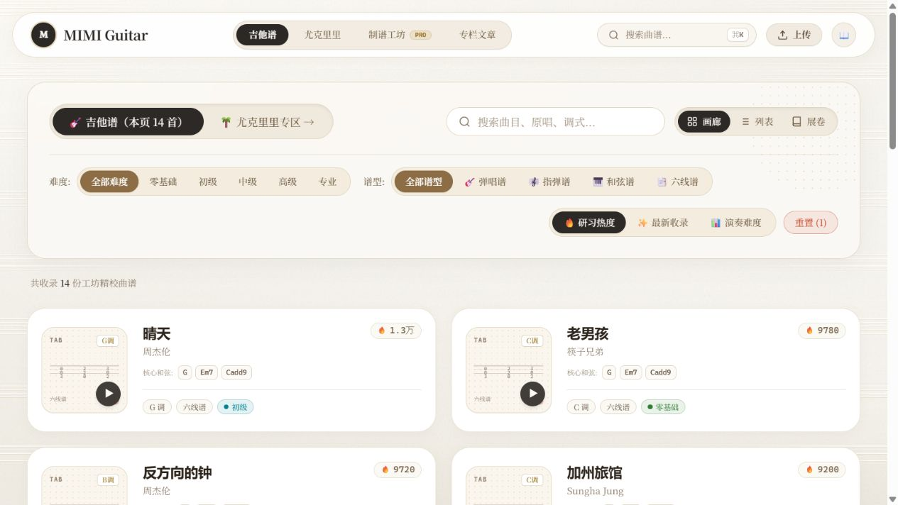
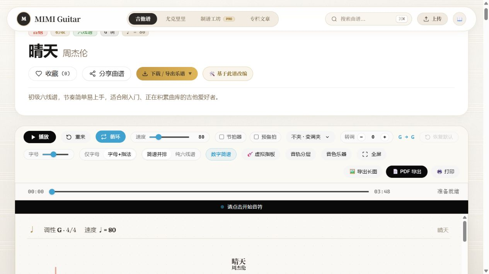
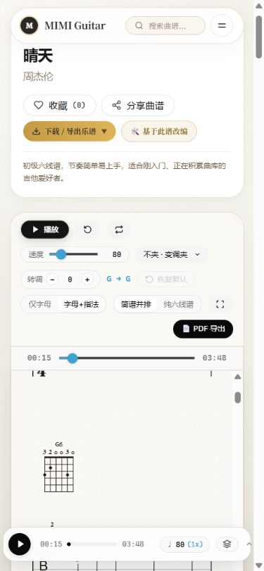
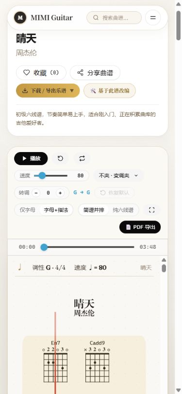
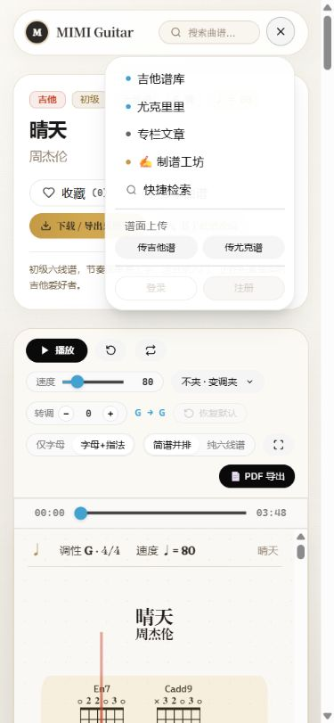
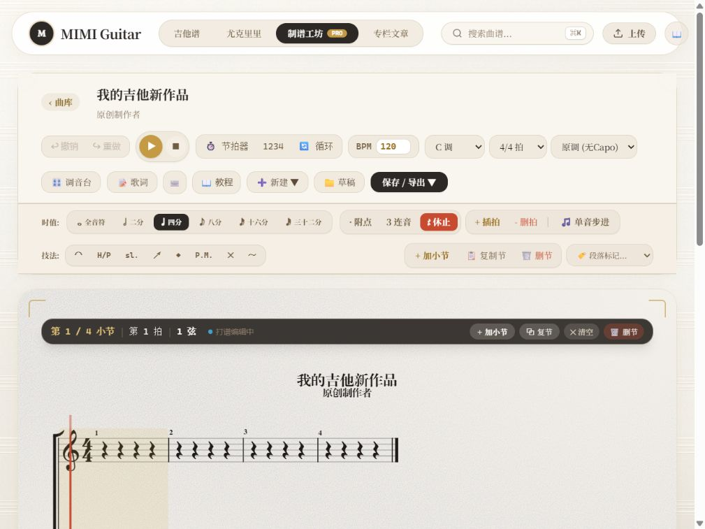

# MIMI Guitar 项目现状审计

日期：2026-10-15（Asia/Shanghai）。范围：代码结构、数据/API、曲库发现、播放器/制谱、本地保存、质量体系与关键页面抽样。目的：制定下一步稳定的个人练习平台计划。本次仅交付审计和文档，未实施功能修复。

## 1. 结论与证据边界

项目已有相当丰富的曲库、播放和制谱基础，但目前不能视为完整稳定的长期练习平台。优先问题是状态真实性、数据一致性、音频生命周期和个人练习闭环；再增加更多视觉或 AI 功能不能替代这些基础。

本次由主线程做代码/构建/浏览器核实，三个子智能体分别只读检查播放制谱、后端运维、产品质量。已有进展与历史测试仅用于定位，以下通过结果均为本次执行。

### 源码与运行基线

- 主工作区：`D:\MIMIguitarweb`，分支 `feature/complete-score-studio`，HEAD `f4ac8ece`。
- 稳定分支 `master`：`55152110`，位于 `D:\MIMIguitarweb-master-merge`；审计开始时该树干净，未配置 Git remote。
- `master...feature/complete-score-studio` 双方独有提交计数 `7 / 1`。不能把工坊分支与 master 当作同一套源码。
- 当前主工作区有 35 个已跟踪文件变化及大量未跟踪页面、OMR/采集代码、测试截图、部署脚本和归档。审计读取的是这个实际工作区；其中未提交 OMR/文章/采集代码不一定存在于稳定版。
- 文档在从 `master` 创建的隔离工作区和 `docs/guitar-platform-roadmap` 分支编写；不将整个 dirty 工作区或功能分支一起合入。
- 浏览器使用本次构建 `.astro/platform-audit-runtime`，端口仅绑定 `127.0.0.1:4327`。没有复用 9 月旧 `dist` 作为当前源码证据。
- 本机 Docker 服务停止、5433 未监听。审计运行时显式指向本机不存在的测试库，未读取 `.env` 值、未访问生产库、未调用模型/采集/部署/投稿写入。

统计范围：源码中 73 个 Svelte 组件、32 个 Astro 页面、19 个 TS API 路由、18 个 `*.test.mjs` 文件。此为目录统计，不表示每个组件、格式或路由都完成浏览器验收。

## 2. 当前功能成熟度

| 模块 | 已有基础 | 未闭环或未验证 |
| --- | --- | --- |
| 曲库/搜索 | 吉他/尤克里里列表、SSR 查询、搜索、筛选、排序、分页、试听 | 当前页本地筛选与全库查询混用，分页/排序语义冲突；DB 故障隐式演示降级。 |
| 播放阅读 | AlphaTab 谱面、播放/暂停、变速、节拍器/预备拍、转调/capo、混音、显示/打印 | 本次只抽样一首；全库、真正可闻输出、长时、真机未验收。 |
| A-B | 详情已有点击拍位选择 start/end | 未保存；反复/跳房子 occurrence、结束拍与触摸操作契约不足。工坊仅全曲循环。 |
| 制谱 | 多轨、弦品/时值/技巧、歌词、撤销/重做、指板和和弦 | 精确拾取、复杂谱保真、备用音频语义、移动编辑需要回归；本次有实际运行错误。 |
| 导入/导出 | 工程 JSON、AlphaTab/IBE/GP/MusicXML/AlphaTex 入口；GP7/IBE/文本/PNG/PDF 导出 | 单文件工程导出不是整机个人数据恢复；支持范围需逐格式真实样本确认。 |
| 个人数据 | 工坊 localStorage 草稿、IndexedDB 原件、每乐器最近 50 条浏览历史 | 多存储源、部分写入不原子；无统一收藏/待练/练习记录/整包备份。 |
| 账号/收藏 | 用户 API、账号页和收藏接口 | 游客被引向登录，失败可能假成功，与此次本地优先需求不一致。 |
| 文章/学习 | 文章列表、固定文章库、编辑器和草稿入口 | 发布只在内存，部分收藏只是 alert；文章来源与详情不一致，无学习进度。 |
| OMR/外部导入 | 当前未提交原型已有处理界面、请求、转换与写文件 | 失败固定谱、伪双轮一致度、写失败成功、未入库跳转；暂不适合作为可靠能力。 |
| 练习工作台 | 播放器可提供部分控制 | 没有待练状态、会话、有效计时、渐进提速和继续上次业务闭环。 |
| 运维/质量 | 部分单测和大量浏览器脚本、部署脚本、上传事务守卫 | 类型错误、测试假绿、CI/模板检查/迁移重放/健康与恢复演练不足。 |

## 3. 本次验证结果

| 项目 | 观察与真实结果 |
| --- | --- |
| Node | `v24.16.0`；npm `11.13.0`。不在本轮升级依赖。 |
| 显式单测 | `node --test 'tests/*.test.mjs'`：111 项，104 pass / 7 skip / 0 fail，exit 0，约 3.02s。7 skip 为 DB 搜索 5 项和谱型 2 项；不能称全库测试通过。 |
| 构建 | `npm run build -- --outDir .astro/platform-audit-runtime`：exit 0，42.13s。Prisma browser external、>500KB 分包警告仍存在。 |
| 首次构建尝试 | 将 outDir 放到系统临时目录时，SSR manifest 无法沿祖先路径找到 `piccolore`，exit 1。改用项目内已忽略目录后通过；这是审计输出位置导致的失败，未改依赖。 |
| 类型检查 | `node_modules/.bin/tsc --noEmit --pretty false`：exit 2，9 处 TS 诊断，见下表。没有独立 Svelte/Astro 模板 checker，因此也不声称模板全类型安全。 |
| Lint / 格式 | 当前没有统一 Lint 脚本，本次未执行应用 Lint；文档另执行 `git diff --check`、本地链接/截图路径与围栏检查。 |
| HTTP | `/studio` 200 / 126446 bytes；`/tabs` 200 / 112675 bytes；`/tabs/1sdc49P3eKm` 200 / 96326 bytes；对应 IBE 200 / 21277 bytes。页面使用 DB 故障演示路径。 |
| 浏览器 | 当前内置 Chromium：1280×720 曲库/详情；390×844 详情与导航；1024×768 工坊。实际截图见第 5 节。 |
| 负例 | `/tabs/audit-missing-20261015` 返回200与《明天你好》；`/article/audit-missing-20261015` 返回200与大横按教程。印证错误ID替换为别的内容；未执行上传、OMR、改密或外部采集。 |
| 声音与真机 | 未监听/分析音频输出；未执行 Android/iOS/iPad 真机、全格式保真、2h 长时或整库资源完整性测试。 |

### 当前 TS 诊断清单

| 文件:行 | 诊断 |
| --- | --- |
| `src/lib/gpUpload.ts:215` | TS2551：`MasterBar.timeSignature` 不存在。 |
| `src/lib/musicResourceCollector.ts:468` | TS2304：`firstKeyLabel` 未定义。 |
| `src/lib/playerSettings.ts:13` | TS2339：`Environment.defaultRenderers` 类型不存在。 |
| `src/lib/playerSettings.ts:192` | TS2551：`NotationElement.EffectDecrescendo` 不存在。 |
| `src/lib/scoreAuditionEngine.ts:266,267` | TS2339 两处：`AlphaTabApi.beatChanged` 不存在。 |
| `src/lib/studio/studioAudioEngine.ts:29` | TS2554：参数数量不匹配。 |
| `src/lib/studio/studioScoreBridge.ts:233` | TS2304：缺少 `StudioBar` 名称。 |
| `src/pages/api/upload.ts:104` | TS2322：回调返回值与 `void/Promise<void>` 不符。 |

本次只修改文档，以上是当前源码基线问题。不能因单测或构建通过而标为全绿，也不能把它们误记为文档引入。

## 4. 风险与可定位证据

等级：P0 为可信基线/数据或核心操作阻断；P1 为首个稳定练习版必须补齐；P2 为后续便利能力。`代码` 表示静态证据，`复现` 表示子线程纯内存/模型验证，`浏览器` 表示本次实际页面。

| ID | 等级 / 证据 | 问题与影响 | 文件位置 |
| --- | --- | --- | --- |
| A01 | P0 / 浏览器+代码+复现 | 音频解锁同步递归；已解锁且新 context 为 suspended 时，register→unlock→register，在 resume 前溢出。平板尺寸工坊实测 RangeError，纯内存假context也复现且resumeCalls=0。 | `src/lib/audioUnlocker.ts:57–60,85–91` |
| A02 | P0 / 代码+复现 | 草稿连续写多个键，第二次配额失败会使直接快照和工程快照版本不同；最新项损坏直接返回 null，隐藏有效备份。 | `src/lib/studio/localScorePersistence.ts:28–30,42–54` |
| A03 | P0 / 代码 | 工程 JSON 只导出单项目，重新导入会新建 ID/改 source，不能恢复原件、其他草稿和全部个人资料。 | `src/lib/studio/studioScoreBridge.ts:321,463`；`studioOriginalFileStore.ts:35` |
| A04 | P0 / 代码 | 未知曲谱 ID 回退第一份演示谱并改成请求 ID；未知文章也回退首篇。错误内容被当成成功，记录身份会混乱。 | `src/pages/tabs/[id].astro:35–38`；`article/[id].astro:17–20` |
| A05 | P0 / 代码 | 收藏写 DB 异常仍返回 ok:true，前端按 HTTP 成功翻转；查询异常又变成空列表。 | `src/pages/api/favorites/[tabId].ts:32–34,45–47`；`FavoriteButton.svelte:63–70`；`account/0.astro:24–25` |
| A06 | P0 / 代码 | SSR 每页 90 条再做本页过滤；分页仅 ?no 丢条件；sort=1 前后端含义不同；调性 includes/精确匹配不同。 | `TabCardGrid.svelte:226–274,949–969`；`tabs/index.astro:37`；`tabQuery.ts:90,96` |
| A07 | P0 / 代码 | DB 错误静默换少量演示数据，数量/资源状况未说明，不能证明保留完整现有库。 | `src/lib/tabQuery.ts:103–149`；`api/search.ts:61–89`；`pages/index.astro:46–47` |
| A08 | P0 / 代码 | OMR 请求失败仍返回 success:true 和固定示例谱；单次结果复制一份当双轮，缺失一致度默认 98%。 | `omr/senseNovaClient.ts:172–179,262–330`；`pdfPreprocessor.ts:54–57`；`SplitScreenProofreader.svelte:245` |
| A09 | P0 / 代码+TS | OMR 保存吞全部文件写错仍成功且不入库；collector 写文件后引用未定义变量，同 ID 重试可能冲突且仍无目录记录。 | `api/omr/save.ts:20–45`；`musicResourceCollector.ts:450–484` |
| A10 | P0 / 代码 | 文章“投递入库”只在内存插入并删草稿；刷新丢内容。文章收藏仅 alert；首页固定样例却写“真实打卡”。 | `ArticlePublishModal.svelte:60–94,135`；`EditorialStudioApp.svelte:14,69–70`；`article/[id].astro:144`；`StudyNotesFeed.svelte:2–50` |
| A11 | P0 前置 / 代码 | A-B 的 getBeatStart 返回首次演奏位置；B 取拍开始，缺反复 occurrence/尾拍语义；不能直接据此做精准续练或提速计数。 | `ScorePlayer.svelte:688–701`；AlphaTab 本地 d.ts `11545–11549` |
| A12 | P1 / 浏览器+代码 | 播放/速度/区间/位置为组件状态；播放约15s后刷新回 0；没有练习会话和恢复模型。 | `ScorePlayer.svelte:92–114,598`；本次手机刷新 |
| A13 | P1 / 代码+模型复现 | 试听 seek 检查 Score.endTick，但总 tick 属于 API；GP5 模型无该属性，±5 秒路径会直接返回。 | `scoreAuditionEngine.ts:458,466,566–569` |
| A14 | P1 / 代码 | 音源超时/异常直接标 ready；api.play 返回值未核实就写 isPlaying，断网可假播放。 | `scoreAuditionEngine.ts:347–375,503–509` |
| A15 | P1 / 代码 | audition/详情/工坊没有统一焦点与跨标签所有权；音频解锁会恢复所有 context，不代表用户要全部续播。 | `scoreAuditionEngine.ts:540`；`audioUnlocker.ts:102–113`；`ScorePlayer.svelte:421` |
| A16 | P1 / 代码 | 工坊备用引擎单轨且不支持完整反复/capo/混音；按音符事件打节拍；界面未明确降级。 | `ScoreStudioApp.svelte:492`；`studioAudioEngine.ts:107,169` |
| A17 | P1 / 代码 | 工坊每次变化整体 tex，点击等宽划拍/硬编码弦间距，混合时值/多轨/缩放与触摸有漂移风险。 | `ScoreCanvas.svelte:347,449` |
| A18 | P1 / 浏览器+代码 | 手机导航没有游客本地资料入口，登录/注册禁用；手机部分循环/重来按钮无可访问名称；平板编辑画布超出首屏。 | `MobileMenu.svelte:86–112`；本次快照/截图 04–06 |
| A19 | P0 质量 / 代码 | 宽泛 test 入口、部分 E2E 只打印/跳过仍宣称成功；没有统一 CI/typecheck/lint；易假绿。 | `package.json:17`；`tests/test-all-routes.mjs:39–52`；`tools/test_score_studio_e2e.mjs:33–84` |
| A20 | P1 运维 / 代码 | schema/migrations 可能不一致；生产依赖遗漏/分类、DATA_DIR、readiness、协调备份缺正式验证。 | `prisma/schema.prisma:39–41`；`omr/imageOptimizer.ts:5`；`screenshot.ts:1`；部署健康检查 |
| A21 | P1 / 代码 | 下载只允许 scores 路径，审核上传仍在 upload 路径，入库与原件下载可能不一致。 | `api/tabs/[id]/download.ts:26`；`api/upload.ts:67` |

目录中的组件路径可由名称唯一定位；行号以主工作区当前源码为准，后续编辑会变化。未提交代码的问题不自动说明已发布服务存在同样问题。

### 公网暴露前的额外阻断

当前部署暴露方式未检查，以下为源码风险，不宣称已经被线上利用。个人首期应关闭不需要的公共写入入口；重新开放前验证：

- `api/auth/send-code.ts:11–13` 直接回传开发验证码，`reset.ts:13–16` 接受其改密；生产模式必须禁用 mock。
- `lib/api.ts:22–29` Cookie secure 固定 false，`astro.config.mjs:9–10` 关闭 origin 检查；按运行模式修复，不能只加前端提示。官方来源校验能力见 [Astro 配置](https://docs.astro.build/en/reference/configuration-reference/#securitycheckorigin)。
- OMR process/stream/benchmark/save 缺少身份、成本、并发与请求体限额；benchmark 可请求 2–10 次外部模型。公开投稿审核目前是上传者自己批准。
- `renderMarkdown.ts:39–60,150–155` 与文章 `set:html` 需要检查允许标签/净化；文章正文大小、作者归属、审核/删除边界也未闭环。
- 未提交 `omr/secureVault.ts` 有代码内派生材料和环境缺失的秘密回退；本次未读取/输出具体内容或验证有效性。实施时移出源码并核查使用情况，实际轮换另在授权范围执行。
- 进程内 rateLimit、可信代理、上传前读取上限和解码后的 PDF/图像资源边界都需补充。

## 5. 本次浏览器流程与截图

本次实际走过的路径为：曲库 → 《晴天》详情 → 循环入口 → 播放/暂停 → 手机尺寸与刷新 → 手机导航 → 工坊平板尺寸。先核对可见状态，再保存同一截图并查看。下列 JPG 是本次新截图，不使用旧 evidence 替代。

| 步骤 | 观察 | 健康状态 |
| --- | --- | --- |
| 1 | 1280×720 曲库可浏览，演示降级显示 14 首，筛选/展示入口可见 | 页面可用；数据来源和筛选语义待修。 |
| 2 | 《晴天》加载完成；循环按钮进入“请点击开始音符”；播放后约15s、tick 20207、第6小节，暂停生效 | 样本谱面与进度可用；未完成 A/B 边界或真实声音验收。 |
| 3 | 改为390×844后控制可见；刷新后资源再次就绪但进度回0 | 手机尺寸部分可用；续练失败，无名图标/缺少部分控制入口。 |
| 4 | 手机菜单有曲库/文章/工坊/上传，但没有本地历史或我的练习，登录注册禁用 | 个人使用入口不完整。 |
| 5 | 1024×768 工坊渲染空白工程；画布 top≈419、bottom≈1038，页面可滚动；日志有 audioUnlocker RangeError | 谱面显示可用，运行错误；固定工作台的首屏与控制区域待改善。 |

本次三个尺寸 document scrollWidth 等于 clientWidth（1265、375、1009），未见页面水平溢出；这不否定截图中的首屏阅读面积、控制密度和 HUD 遮挡风险。已查看导航、曲目头部、主播放控制、手机 HUD 与工坊谱面；未检查每个抽屉、长谱尾部、导出对话框和屏幕阅读器。浅色小字/小图标的对比和触达风险需要后续测量，不能声称无障碍合规。

日志中的 RangeError 在新构建页面观察到，根因由调用关系定位，尚未修复。截图本身不包含控制台，因此不能用截图单独证明该错误；相关栈为 `audioUnlocker` 中 a/f 互相调用。

## 6. 下一阶段行动

先执行 M0：收敛源码基线、修音频递归与类型错误、统一错误/保存状态、修曲库查询和可信测试。随后建立本地资料层并尽早完成整包备份恢复，再把播放器接成练习工作台。

完整排期、模型、状态/时序与完成标准见 [开发计划](platform-development-plan.md)，可直接执行的任务依赖与验收矩阵见 [清单](platform-backlog-and-acceptance.md)。三份文档经子智能体只读复审后补充了恢复并发保护、时间片幂等、多卷完整性、下载状态真实性和首个练习纵向切片。本次没有把任何待实现能力记为完成。

## 7. 本次文档交付与保护检查

本次变更仅为三份平台文档、六张本次截图，以及 README/PLAN/UPDATE_PLAN 的入口和历史状态说明；没有修改应用源码、依赖、数据库或部署。

提交前检查：原主工作区1014个受检文件SHA-256全部一致，Git status差异0，分支仍为 `feature/complete-score-studio`、HEAD仍为 `f4ac8ece`。检查排除凭据/秘密文件与数据库归档内容，未读取其值；忽略的构建缓存不纳入源码完整性声明。

文档回归：`git diff --check`，6个文档的22个本地链接/截图路径和Markdown代码围栏检查通过；交付采用独立文档提交及 `--no-ff` 本地合并，合并后的校验记录以 Git 与最终交付说明为准。应用基线中的9个TS错误与运行时P0尚未修复，不受此次文档变更影响。
