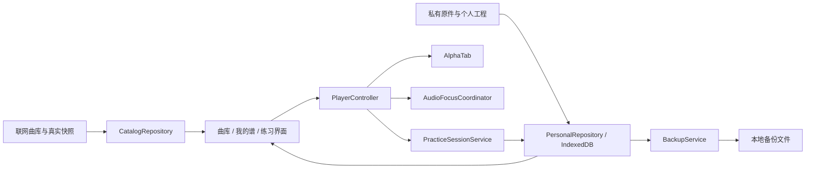

# MIMI Guitar 个人练习平台开发计划

版本：1.4；更新：2026-10-17（Asia/Shanghai）。状态：个人练习核心、交互动效 P1 与工坊 P2-A 已实现并分别记录本地验收，设备与长时门槛保留。本文是完整路线，当前代码交付、实测证据与范围调整见[实施记录](platform-implementation.md)，不能将全部规划视为完成。

新增[交互动效详细计划与验收](interaction-motion-plan.md)和[交互体验 P2/P3 路线图](interaction-experience-roadmap.md)，统一动效规范并按工坊、备份、播放器与曲库拆分后续增量。

工坊 P2-A 的独立实施与验收见[制谱工坊交互与可靠性优化计划](studio-interaction-polish-plan.md)：统一弹层、版本受控歌词、草稿提交边界、局部键盘和工作台动效。本地未应用歌词输入属于页面内暂存；应用并保存成功后才进入工程备份。

本文与 [现状审计](platform-audit-2026-10-15.md)、[任务与验收清单](platform-backlog-and-acceptance.md) 一起，作为下一阶段开发依据。旧 `PLAN.md` 的 M0–M9 状态保留为历史记录，不能替代当前验收。

## 1. 产品目标与已确认边界

把现有曲库、播放器和制谱工坊连接成可以长期使用的个人练琴平台。核心流程：**找谱或导入 → 加入待练 → 分段练习 → 保存记录 → 下次继续 → 备份恢复**。

| 访谈 | 用户选择 | 实施约束 |
| --- | --- | --- |
| 1：首要用户 | 个人自学与日常练琴 | 优先日常闭环；教师、班级、社交不进入首期。 |
| 2：数据归属 | 单设备本地，完整导出与恢复 | 无需登录即可收藏、待练、记练习、保存个人谱；不承诺跨设备自动同步。 |
| 3：内容 | 主要自己使用，保留现有曲库与个人导入 | 不扩大采集；不把公开投稿或 AI 识谱作为首期依赖。 |
| 4：设备 | 电脑、平板、手机基础功能都可靠 | 共用数据契约，分别设计操作密度；真机证据分别验收。 |
| 5：新增功能 | 待练、A-B、逐步提速、记录、继续上次 | 详情页已有 A-B；升级其可靠性及持久化，不重复开发。 |
| 6：网络 | 联网找谱，断网明确提示缺失资源 | 本地数据可备份恢复；首期不承诺站点或全曲库完全离线。 |

首个稳定版本的成功标准：无需账号，用户能在三类设备上完成上述完整流程；中断、刷新、损坏导入、存储空间不足不会静默丢失已提交数据；任何“已保存、已播放、已恢复”都对应真实完成的操作。

练习时长定义为应用可观察到的有效伴奏播放时长；没有麦克风分析，不能宣称识别了用户实际演奏。“掌握”由用户自评。首期不需要麦克风权限。

## 2. 当前基础与优先次序

继续使用 Astro 5 + Svelte 5 + Tailwind v4 + AlphaTab 1.8.4。现有 PostgreSQL/Prisma 继续提供联网曲库；个人练习数据使用浏览器 IndexedDB。首期不更换框架、不引入微服务、不同时升级核心乐谱引擎。

当前基础可复用：曲库 SSR、GP/IBE 解析、详情播放/变速/节拍/循环、工坊编辑与导出、导入原件保管、谱源校验与部分上传事务守卫。

审计时的主要缺口：失败被包装成成功；音频解锁已实测递归溢出；类型检查不通过；筛选和分页不一致；个人资料分散；没有练习业务模型；音频就绪和独占不统一；整包备份缺失。已发生的递归故障在 M0 独立修复，不等待 M3 重构。审计描述保留为问题来源，当前修复结果以实施记录为准，不能用旧“完成”标记跳过验证。

优先次序：**可信基线 → 本地资料和备份 → 播放状态 → 练习工作台 → 工坊与三端收口 → 长期学习工具**。安全与公共接口问题按暴露场景处理，但个人使用也不能依赖假成功。

## 3. 信息架构与使用路径

| 入口 | 用户任务 | 设计约束 |
| --- | --- | --- |
| 曲库 `/tabs`、`/ukulele`、搜索 | 找到合适且资源真实可用的谱 | URL 统一承载关键词、筛选、排序和页码；返回保持条件。 |
| 我的练习 `/practice`（新增） | 继续上次、待练、在练、已掌握 | 对游客可用；首屏突出继续上次与今日待练。 |
| 详情播放器 | 阅读、选段、变速、伴奏练习 | 将已有控制接入统一控制器；提供明确的开始/暂停/结束练习。 |
| 我的谱 `/library`（新增） | 个人导入、个人改编与曲单 | 库谱引用与私有谱区分来源；原件与编辑版本分别保管。 |
| 制谱 `/studio` | 新建或改编、保存、导出 | 默认另存个人副本，保留来源原件及转换警告。 |
| 数据与备份 `/settings/data`（新增） | 查看占用、导出、校验、恢复 | 显示保存状态、最近备份；清理前列出影响并提供救援导出。 |
| 文章与工具 | 学知识、查和弦、后续基础训练 | 现有文章先保证真实可保存；独立调音器和课程排后。 |

复用现有暖纸、墨色、金色强调和谱面视觉。首页逐步加入本人最近练习和继续入口，固定“真实打卡”示例要标明或替换。手机导航直接显示“我的练习 / 我的谱 / 数据与备份”，不藏在登录菜单中。

手机把播放、暂停、选段和结束放在能触达的主区域，次要参数放入有名称的抽屉；平板横屏优先阅读面积，侧栏可折叠；电脑可展开参数。浮动 HUD 与正文控制共用状态，不能遮挡谱面点击和结束按钮。

## 4. 技术边界与模块职责

建议目录职责（新增路径是计划，尚不存在）：

| 模块 | 建议位置 | 职责 |
| --- | --- | --- |
| 曲库仓库 | `src/lib/catalog/` | 规范查询、DB adapter、真实快照 adapter、资源状态；不写个人进度。 |
| 本地仓库 | `src/lib/personal/` | IndexedDB schema、事务、revision、多标签通知、迁移。 |
| 共享播放控制 | `src/lib/player/` | 谱源加载、播放事件、区间/位置契约、生命周期和音频焦点。 |
| 练习领域 | `src/lib/practice/` | 待练状态、会话、有效时间片、提速计划和恢复。 |
| 备份恢复 | `src/lib/backup/` | manifest、附件校验、预检、合并/恢复、事务切换。 |
| 新界面 | `src/components/practice/`、`src/components/library/` | 展示领域状态与操作结果，不直接散写 localStorage。 |

使用现有 IndexedDB API 和运行时校验基础。压缩包读写可以在依赖审查后选择一个维护中的库；不为了小数据引入整套状态框架。Worker 仅用于大文件摘要/打包等可测量的阻塞操作。

### 4.1 本地数据模型

数据库建议命名 `mimi-personal`，数据库版本与业务 schemaVersion 独立管理。所有主实体带 `id`、`schemaVersion`、`revision`、创建/更新时间；时间用 UTC 存储，显示和日统计另记录时区。

| 实体 / store | 核心字段与约束 |
| --- | --- |
| `scoreRefs` | `sourceKind: catalog/private/project`、sourceId、谱面 revision、contentHash、标题/艺人/乐器快照、resourceState。ID 不能仅用文件名。 |
| `assets` | 私有原件 Blob、大小、MIME、SHA-256、文件名；按 hash 去重；不得被编辑覆盖。 |
| `projects` | 工坊工程、原件引用、来源引用、父版本、转换报告；与原始谱独立。 |
| `collections` / `collectionItems` | 曲单名称、顺序、收藏/待练标记；添加同一引用幂等。 |
| `practiceItems` | `todo/practicing/mastered/archived`、目标、难点、目标速度、曲谱引用。 |
| `segments` | 谱版本、稳定谱面锚点、演奏 occurrence、起止规则、可读小节/拍号。 |
| `playerPreferences` | 每谱速度模式、转调、capo、音轨选择/混音、显示偏好；校验范围。 |
| `practiceSessions` | 会话状态、scoreRef、区间、设置快照、幂等结束 ID、时区、时间片、备注、自评；时间片含稳定 sliceId/sequence、所有权 epoch、已确认时长。 |
| `resumeStates` | 最近会话、最后确认位置、谱版本和设置 revision；加载失败不覆盖良好断点。 |
| `meta` | schema/migration、活动数据代次、最近成功备份、数据健康状态。 |

收藏是个人书签；待练是带状态和目标的项目，两者可以关联但不混为一个布尔值。浏览记录继续保留独立语义，不能自动当作练习完成。

### 4.2 保存、迁移与冲突

1. 保存等待 IndexedDB `transaction.oncomplete` 后才显示成功；失败时保留内存中的未保存工程并提供导出。
2. 原件与元数据提交到同一事务；摘要计算和格式解析在事务前完成，不能在活跃事务中等待网络。
3. 旧 `mimi_studio_draft_*`、最新快照、浏览历史和旧原件库做幂等迁移；先读、校验、写新库、校验引用，再标记迁移完成。首次迁移不删除旧数据。
4. 损坏项目单独隔离、可下载原始内容；不要因为一份最新快照损坏而隐藏其他有效草稿。未知未来版本拒绝载入。
5. 多标签采用 revision 比较和 `BroadcastChannel` 更新通知；通知只是提示，事务内 revision 才是冲突判定依据。冲突可另存副本，禁止静默覆盖。
6. 对音频和有效练习计时设置唯一活动会话所有权；支持时使用 Web Locks，退化为 IndexedDB 租约并实测冻结/崩溃接管。失去所有权立即暂停，不依赖通知可靠送达。
7. 网站域名、协议、端口变化会改变浏览器数据空间；部署前固定使用入口，并通过导出/恢复迁移，不能承诺更换域名自动找回。
8. 原件按 hash 共享后，垃圾回收的引用根包括活动/回退代次、进行中的迁移/恢复和导出快照；只清理无引用附件，保留回退所需原件。

浏览器存储有容量和回收策略；申请持久存储、查看占用可以降低风险，外部文件备份仍是必要能力。依据：[MDN Storage](https://developer.mozilla.org/en-US/docs/Web/API/Storage_API/Storage_quotas_and_eviction_criteria)。

## 5. 播放与练习契约

### 5.1 共享播放器状态

状态至少包括：`idle → loadingScore → rendering → loadingAudio → ready → playing/paused → ended`，失败分别为 `scoreMissing / decodeError / renderError / soundfontMissing / audioBlocked / networkError`。后台、丢失音频焦点和保存失败分别处理，不压成一个 `isPlaying`。

只在真实播放器确认开始且音源就绪后显示播放。音源超时不能变成 ready；Web Audio 备用引擎若保留，界面必须说明其音轨和技法能力。页面/谱源 generation 变化时取消旧请求，销毁监听器、引擎、RAF、Object URL，旧事件不得污染新曲。

音频焦点覆盖首页/曲库试听、详情、和弦试听、工坊和以后节拍器。一次用户播放意图只允许一个主音源持续播放；跨标签亦需规则。解锁 AudioContext 不等于恢复全部旧播放器。

### 5.2 A-B 与演奏位置

AlphaTab 原生支持基于 MIDI ticks 的 `playbackRange`，可复用现有能力；参见 [官方 API](https://www.alphatab.net/docs/reference/api/playbackrange/)。当前实现需要补充业务契约：

- 区分谱面位置（轨/谱表/小节/拍）与展开后的演奏位置（反复第几次、跳房子路径、tick）。不要只存裸 tick。
- 首期默认选择谱面区段，界面明确显示选中小节/拍与演奏次数；有歧义时要求选择 occurrence，不悄悄跳到第一次。
- 用户选择的 B 拍应包含完整结束拍；内部区间统一为 `[startTick, endTick)`，终点由展开演奏计划计算。单拍区间允许；倒序归一化后展示确认；越界拒绝。
- 变速、反复、跳房子、休止、不同拍号、终曲尾拍都有专用夹具。切曲、换版本、改变可映射轨道后重新验证区间。
- 谱文件 hash 变化时保留旧记录并将旧区间标为待重定位，不能套用到另一编配。
- 触摸选择提供可见的“设 A / 设 B”或小节输入，不把精确点小音符作为唯一方式；键盘可做同样操作。

### 5.3 渐进提速

模式分固定速度和练习提速。提速计划包含起始速度、目标速度、步长、每级完整演奏次数、预备拍和上限；如 `60 → 65 → … → 90 BPM，每级 3 次`。

只有引擎确认完整经过有效区间且没有中途 seek、暂停、音频失败或后台中断，才累计完成次数。达到次数后在区间边界提速；禁止用时间进度回跳猜测循环完成。达到目标后保持或提示结束，不能继续超限。

手动改速、修改区间或改变谱版本时开始一个新的提速阶段；保留之前记录。变速谱以选中 occurrence 的 A 点原生速度为基准实现倍率：例如全曲起始80、A点原生120、目标A点60 BPM，倍率为60/120。后续原始 tempo changes 保留；界面显示“A点目标 BPM + 倍率”。

步长必须大于0，每级次数为正整数；`next = min(current + step, target)`。达到目标后默认保持目标速度，用户自行结束。持久化 planRevision/currentLevel/completedLaps；暂停/seek 只使当前未完成圈作废，保留此前完整圈；引擎循环事件按稳定 lap ID 去重，重开时不重复提速。

### 5.4 记录、计时与继续上次

会话状态：`prepared → active ↔ paused → completed`，崩溃/离开为 `interrupted`，可继续同一会话或结束保存。重复结束同一会话必须幂等。

- 用户显式开始；仅前台、拥有音频焦点、资源正常且引擎实际播放时累计“伴奏练习时长”。暂停、加载、seek、预备拍、循环等待间隔和失焦不累计。
- 如需无伴奏练习，后续另加明确计时模式，不能混用伴奏时长。首期统计不证明用户真实弹奏。
- 时间差使用单调时钟，按事件关闭时间片，每5秒检查点一次。只有正常持续提交时，意外中断最多丢最后一个检查点；连续写失败或事务阻塞时不承诺5秒上限，明确“未保存”，停止推进已提交时长并提供救援导出。重开不通过墙钟补算缺口。系统时钟跳变不增加时长。
- 跨午夜按会话记录的时区拆分时间片；保留 UTC 原始时间和 timezone，以便解释旅行或修改时区。
- 继续上次顺序：核实谱源/hash → 加载排版 → 恢复可映射轨道/显示 → 恢复速度/转调/区间 → 定位最后确认位置 → 等待用户手势播放。不自动发声。
- 本次未保存状态、上次成功保存时间和重试操作必须可见。重试不能重复记录时间片或覆盖较新的断点。

## 6. 整包备份与恢复规范

当前采用公开版本化 JSON 清单与原生二进制分卷（v2），保留单文件 JSON（v1）兼容；不做加密包装。原 ZIP 建议已由分卷协议取代，具体文件结构见[数据契约](personal-data-contract.md)。备份不含账号令牌、Cookie、服务端凭据或全部联网曲库和 SoundFont。

manifest 记录格式版本、应用版本、导出时间、实体计数、文件路径、字节数、SHA-256 与引用关系。必须包含个人工程、导入原件、曲单/收藏、待练状态、A-B、设置、练习记录、断点及用户备注。对库谱保留 ID/版本和元数据快照；备份不代表今后该联网资源永远可用。

导出从一致的数据 revision/代次读取，避免导出中途编辑造成断链。普通浏览器只记录“文件已生成”和“已发起下载”，不声称最终磁盘保存成功；如使用受支持的文件句柄，只有写入并 close 成功才记写入完成。另设“最近校验/恢复演练”记录，由重新选择备份并实际校验/恢复产生。

恢复分六步：

1. 读取 manifest，检查格式/版本和容量边界，不覆盖当前数据。
2. 校验全部附件长度/摘要、实体结构/外键、重复 ID、本地资源路径和所有文件总量；拒绝非法路径、超限或未来版本。
3. 展示新增、相同、冲突和缺失资源预览。相同 hash/revision 跳过；工程/备注冲突可保留两份并重映射引用。练习会话/时间片按稳定来源 ID 去重，检查点以单调 sequence 合并；不兼容的分叉保留冲突副本但只让一个确定版本进入统计，两种恢复顺序必须得到相同总时长。
4. 首期只做合并恢复，保留现有内容。未来若增加整库替换，先保留可回退代次并单独确认影响。
5. 校验/摘要在事务外完成；活动练习先保存检查点。预览时记录 activeGeneration/globalRevision/restoreEpoch，staging 完成后在切换事务内再次比较；任何数据变化都取消切换并重新合并预览，不覆盖预览后的新写入。切换后旧标签必须重新读取活动代次才能写。取消、配额不足或崩溃时继续使用旧代次；异步清理遵守所有引用根，不能删回退原件。
6. 恢复后显示各类数量与校验结果，实际打开一份私有谱和工程；缺少外网库谱显示缺资源，不伪造可播放。

当前硬预算：单附件 30 MiB，v1 整文件 64 MiB；v2 manifest 64 MiB、每卷负载 8 MiB、最多 128 卷，全部文件连同卷头总计 1 GiB。统一写入另限引用附件 927 MiB、500 份附件、10,000 个实体和 60 MiB 资料 JSON，为封装保留空间；实际 next-fit 卷数也必须合规。完整 1 GiB 与真机容量未实测，不能将预算当作性能承诺；禁止一次读取所有附件到内存。

多卷属于同一不可变快照，每卷带快照标识、序号/总卷数和摘要；附件按 hash 关联，逐卷读取/校验写入 staging。恢复前必须选齐全部卷，缺卷、混用快照、重复冲突卷均拒绝完整恢复；全部验证后才做一次原子合并。超预算时明确拒绝；首期没有部分子集导出，不用部分文件冒充完整备份。

## 7. 曲库、私有导入与工坊

曲库是联网数据源。先保证现有 PostgreSQL 的迁移、备份与只读查询可复现；若为个人本机常用，新增可选的真实元数据快照，标识生成时间与版本，资产仍逐项检查。少量 `DEMO_TABS` 必须标为演示，不能代替完整曲库，也不能把未知 ID 映射到第一首谱。

查询参数单一来源：服务端验证并返回结果、总数、有效筛选和页码；前端操作更新 URL 再查询；本页快速筛选若保留必须明确命名。页码越界归一，空结果保留条件和清除入口；筛选、排序、分页、后退保持一致。

私有导入：选择文件 → 类型/大小/结构校验 → 解析与转换报告 → 保管原件 → 原子提交个人库记录 → 打开阅读/改编。失败前后保留当前工程和原件，不上传服务端。GP/IBE/AlphaTex/MusicXML 等支持范围按真实夹具逐一声明。

工坊先保留能力边界：原件不变、另存个人副本、损失报告可见、错误回滚。后续修复多轨/混合时值/缩放的点击拾取，逐步拆分大组件；不得把重构和格式扩容放在同一次提交。GP/IBE 导出用语义快照回读验收，不能只检查“小节数相同”即宣称无损。

OMR、外部 URL 采集、公开投稿在首期作为关闭或明确实验性入口；现有代码中的固定谱/虚构置信度/假保存必须先移除成功语义。将来重新开放须有真实样本准确率、费用边界、取消超时、错误保存、来源标记及完整落盘闭环。

## 8. 可靠性、性能与三端标准

首期支持目标：Windows Chrome/Edge；Android Chrome；iPhone Safari；iPad Safari 横竖屏。版本在实际验收时记录，不凭 Chromium 视口模拟声明 Safari 通过。至少覆盖 390×844 手机、768×1024 平板竖屏、1024×768 平板横屏、1366×768 与 1440×900 桌面。

核心流程无页面横向溢出；谱面自身可按明确设计缩放/滚动。手机触控目标以 44 CSS px 为目标，图标控件有名称；键盘、对话框焦点/返回焦点、状态读屏、200% 放大与减少动态效果分别检查。不能为获取“无溢出”而隐藏必要功能。

以下是待实现的验收预算，不是当前已达到的性能：

| 指标 | 首期目标与测量条件 |
| --- | --- |
| 点击播放到实际进度 | 资源就绪桌面 ≤1s、目标手机 ≤2s；首次音源加载单独统计，不报假 ready。 |
| 阅读可用时间 | 固定中等夹具与本机正常网络冷缓存 ≤5s；超时保留进度和重试。先测设备基线后冻结预算。 |
| 保存反馈 | 小工程/练习元数据事务提交 P95 ≤300ms；失败有明确未保存提示。 |
| 长时间练习 | 桌面 2h、各目标移动设备至少 30min；切曲 50 次后无叠音、串状态、累积监听器。 |
| 内存 | 相同谱反复切换后稳定，稳定阶段不持续增长；单次尖峰和 GC 波动单独记录，不凭单次读数判泄漏。 |
| 数据恢复 | 所有已提交实体、原件字节及引用关系一致；失败恢复零覆盖。 |
| 控制交互 | 旋转、缩放、抽屉开关不重建当前会话或丢进度。 |

## 9. 阶段、依赖与工作量

工作量为单开发者有效工作日的粗估，不是固定交付日期；包含实现、针对性测试和文档，真机资源不足时会延后验收。先在 M0 结束重新估算，禁止为了赶时间跳过数据/真机门槛。

| 阶段 | 预估 | 核心交付 | 依赖与完成门槛 |
| --- | --- | --- | --- |
| M0：可信基线 | 4–7 天 | 源码收敛、音频递归、9 处类型错误、测试入口、筛选/错误状态、曲库资产盘点与空库迁移核验、关闭假成功原型 | 只提取审核过的改动；构建/类型/针对性测试真实通过；保留原工作区。 |
| M1：个人资料底座 | 5–8 天 | IndexedDB、身份/版本、迁移、本地收藏/曲单/待练、私有导入 | M0；事务、坏数据、配额、冲突测试通过。 |
| M2：备份恢复 v1 | 4–6 天 | 覆盖当时已支持的个人数据，manifest/多卷、校验预览、合并/替换、失败回退 | M1；空浏览器完整恢复及坏包/取消/配额/并发切换场景通过。 |
| M3：共享播放与续练 | 5–8 天 | 音频独占、真实就绪、seek、演奏位置契约、A-B/设置持久化 | M1；反复/跳房子/变速/资源失败/双标签夹具通过；调整数据后 M2 回归。 |
| M4：练习工作台 v1 | 6–9 天 | 先交付固定速度A-B、结束备注、续练与备份的纵向切片，再加渐进提速和周回顾 | M2+M3；每种新增实体当批可备份恢复；不做自动演奏评分。 |
| M5：工坊与三端稳定版 | 5–8 天 | 精确拾取、导入导出闭环、手机/平板控制、无障碍、长时测试、运维收口 | M4；真机矩阵/恢复演练完成，未知项不能当通过。 |
| M6：长期学习扩展 | 每包 2–5 天，按需 | 独立节拍器/和弦工具、分级教程与进度、可选调音器 | 首个稳定版使用反馈；一次只增加一个闭环并回归。 |

M0–M5 合计约29–46个有效工作日；设备验证与不确定格式兼容另留机动。M1+M2 是个人资料可用增量。首个完整练习切片在 M3 后接入 B19/B20 的基础会话：一份支持谱→待练→固定速度A-B→结束备注→重开继续→备份恢复；不等待自动提速、周报和完整工坊优化。目标稳定练习版以 M5 验收为准。

## 10. Git、测试、发布与维护

当前主工作区含大量用户改动，下一阶段从明确稳定基线创建隔离分支，逐个核对已提交工坊与未提交页面/导入代码。不得整包复制工作区或顺手提交部署归档、数据库 dump、密钥文件和截图缓存。`master` 与功能分支不是同一代码集，合并前先验证组合。

建议分支按里程碑使用 `fix/platform-trust-baseline`、`feature/local-personal-library`、`feature/personal-backup-restore`、`refactor/shared-player-controller`、`feature/practice-workbench`。每包最小可运行提交，使用 `type: summary`；文档同步；验证后 `merge --no-ff`，主分支回归。推送、PR、发布不在本次规划授权范围内。

测试分层建议：`test:unit` 明确 `tests/*.test.mjs`；`test:integration` 在一次性数据库与浏览器存储跑真实事务；`test:e2e` 指定本地 baseURL/fixture，强断言且失败非零退出；`typecheck` 覆盖 TS 与 Svelte/Astro 模板；按现有格式制定 lint/format 后再接 CI，避免无关全仓格式化。

生产迁移使用可重复的部署命令，先在空临时数据库重放再验证 schema；不对个人正式库直接跑试验性 `migrate dev`。`DATA_DIR` 放在版本化程序目录之外，统一原谱/截图/上传路径；发布只替换程序。

健康检查分 liveness、曲库 readiness 与外部可选能力。首页 200 不代表数据库、谱文件和音源健康。错误日志含请求 ID/错误码/谱源 hash，不记录原件正文、账号秘密；个人数据默认不上传遥测。

本机个人备份与服务端曲库资产备份是两套流程：曲库数据库、原谱、音源与来源清单协调备份，至少做一次空目录恢复演练。发布保留上一程序版本；迁移保持兼容，需回滚时用可恢复方案和 `git revert`，不改写共享历史。

若以后对公网开放，需另完成真实找回密码、Cookie/来源校验、权限/审核、请求大小与 AI 成本限额、秘密移出代码等门槛。当前仅规划，未执行线上调用、密钥轮换或部署。

## 11. 完成定义与后续决策

首个稳定版必须能演示：新浏览器无需登录 → 找到一份真实库谱/导入一份私有谱 → 待练 → 选区/提速 → 结束并保存 → 关闭重开继续 → 导出 → 在另一空浏览器恢复并打开原件、工程和记录。损坏输入、配额、断网和多标签场景也要通过。

不能用单元测试代替浏览器声音输出，不能用桌面模拟代替 iOS/Android 真机，不能用单工程导出代替整包恢复，不能用成功提示代替落盘。任何未执行项在发布表中明确列出。

M0–M5 的个人练习核心已进入实现和集成验证。后续先关闭本次代码验收发现的问题，再补足真实 PostgreSQL、目标真机、完整资源和长时发布证据；M6 学习扩展仍按实际使用反馈独立排期。对计划的反馈以本文件的目标/优先级/验收项修改并记录版本，避免再次产生多个互相矛盾的开发计划。

## 12. 2026-10-16 收口执行计划

用户追加要求：可交给子代理的开发全部由 `gpt-6-luna`、`max` 推理执行。并行范围以文件所有权隔离，协调者负责浏览器实测、接口审查、Git 与结果核对。

| 工作包 | 负责代理 | 实现顺序与边界 | 冻结前检查 |
| --- | --- | --- | --- |
| 练习可靠性 | luna_max_practice | 保存实际播放倍率，兼容旧断点；验证私有/工程附件；中断作废未完成圈；目标速度封顶；收口手机 HUD | 变速谱 A 点与曲首速度不同、重复事件、暂停/seek/失焦、短时片段、手机控件；目标单测和模板检查 |
| 工程到练习与导出 | luna_max_studio | 当前工程经 AlphaTab 编成 IBE，工程/谱/待练/附件同事务保存；旧断点保留版本；官方 bounds 命中；导出失败不下载空文件 | 异步编码期间的版本冲突、多轨/混合时值/缩放、导出回读、PNG/PDF 失败和资源清理 |
| 数据与运行状态 | luna_max_data_ops | JSON 数据普通化后提交；保留 v1，新增 v2 清单和二进制分卷；staging 逐附件校验后 CAS 原子合并；readiness 与公开入口关闭 | 深层响应式 Proxy、缺卷/混卷/篡改/取消/配额/旧预览、版本阻塞、DB 失败、关闭入口零副作用 |
| 集成与交付 | 协调者 | 冻结源码→独立依赖镜像检查→fresh build→浏览器正常/故障流程→文档→本地提交与 no-ff 合并→主分支回归 | 退出码、来源分支、原工作区 1,014 文件摘要与 Git 状态、真机和数据库未测项单列 |

分卷实现采用 JSON 清单与原生二进制文件，替代原建议 ZIP，减少 Base64 内存膨胀；下载由用户逐卷发起。v1 单文件继续可读。v2 每卷 8 MiB、逻辑总量 1 GiB 是硬预算，最终协议和实际测试规模见数据契约，不把预算写成真机性能结论。首期恢复采用合并，不提供会删除现有内容的整库替换；保留旧实体和附件作为恢复基础。
