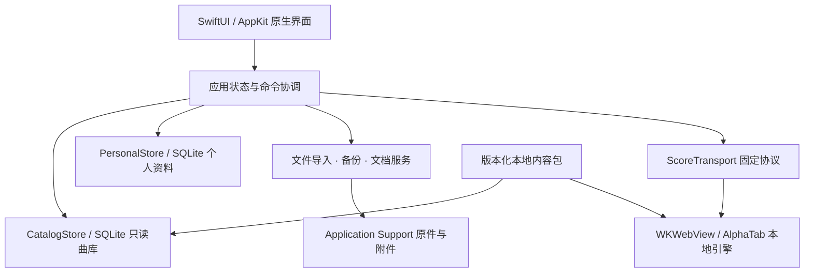

# MIMI Guitar 原生 Mac 迁移计划

日期：2026-10-24（Asia/Shanghai）  
负责人：主代理负责架构、计划、分工和集成审查；GPT-6-Luna，reasoning=max，子代理负责实现。  
工作分支：`feature/macos-native`；默认交付可审查的工作区改动，不创建提交、不推送、不发布。

> 当前明确的交付范围：原网页所有有效页面、视觉细节、操作、状态与数据流程完整迁入原生 Mac 应用，不能用框架、占位页或删减功能替代。此前 0.1.0 是未完成原型，不满足此交付标准。下面 M0–M6 是同一任务的内部实施顺序，不能以完成 M1 为由结束任务。逐项范围与结果跟踪见 `FULL-PARITY-MATRIX.zh-CN.md`。

## 1. 产品目标与默认决策

做一个可拖入 Applications 安装、能离线使用的 Mac 乐谱与练习应用。保留原站首页、完整导航、纸页视觉与全部有效功能；本地搜索、文件、窗口、快捷键和音频操作符合 Mac 的使用方式。原站联网账号和文章发布使用可配置的真实服务，离线曲库、个人资料、练习与工坊独立运行。

默认架构为 **SwiftUI + AppKit 原生应用界面，SQLite 本地数据，WKWebView 内嵌 AlphaTab 1.8.4 谱面组件**。WebKit 的范围限制在乐谱排版和现有合成器；曲库、导航、工具栏、搜索、设置、文件对话框、收藏和练习控制使用原生界面。正式运行不需要 Node、PostgreSQL、Docker、浏览器标签页或本地 HTTP 服务。

这一选择保留既有谱面兼容性，同时逐步迁出网页应用的其余部分。它仍包含 JavaScript 谱面引擎。若另要求排版、GP 解析和音频合成全部改写为 Swift，应作为独立的引擎研发项目评估，不与本次界面/数据迁移混报完成。

默认支持 macOS 13 及以上、Intel 和 Apple silicon。先在现有 Intel Mac 完成本机原型，再增加 arm64 构建及真机验收。初始发行渠道为本地 `.app`/`.dmg`，正式对外分发走 Developer ID 签名与公证。Mac App Store、云同步、多用户服务和订阅系统另行立项。

## 2. 已核对的工程与设备事实

| 项目 | 本轮观察 | 对迁移的影响 |
| --- | --- | --- |
| 当前应用 | Astro SSR、Svelte、Prisma、PostgreSQL 16、AlphaTab 1.8.4 | 原生版需要替换页面/服务层，保留领域算法和谱面引擎 |
| 曲库 | 16,233 条 Tab，8 篇 Article，4 条已应用迁移 | 制作版本化只读 SQLite 内容包；不能把演示曲目当作完整曲库 |
| 曲谱引用 | 12,106 份谱文件引用、4,127 份 XHE 引用 | IBE/GP 与文本和弦谱分别处理；XHE 不应显示虚假的音频能力 |
| 媒体 | 迁移包记录 storage 32,599 文件、555,536,315 字节；另有公共音源/字体 | 完整离线内容体积主要来自媒体，应与应用更新策略分离 |
| 个人资料 | 浏览器 IndexedDB：收藏、待练、片段、会话、断点、工程、附件 | PostgreSQL 导出不能迁移这些内容；必须兼容现有备份 |
| 播放器 | `ScorePlayer.svelte` 3,579 行；既有设置关闭 worker，使用 ScriptProcessor | 先提取明确的引擎适配接口，后续测量 worker/AudioWorklet 兼容性 |
| 工坊 | 原生 StudioProject 模型、原件保留、GP/IBE 导出及格式损失报告 | 必须保留原件及转换告知，不能宣称所有格式无损 |
| 当前 Mac | Intel x86_64，macOS 13.7.8，Swift 5.8.1，CLT SDK | 使用 macOS 13 可用 API；不用 SwiftData、@Observable、新版专属动画 |
| 工具链 | 有 `swift`、`sqlite3`；没有 `xcodebuild`；SwiftPM目前遇到CLT的PlatformPath元数据错误 | 先尝试SwiftPM，提供显式SDK的swiftc静态链接回退；完整Instruments/发行流程需匹配的Xcode |
| 网页服务 | 已运行在 Docker，固定 `127.0.0.1:4336` | 保留为行为对照；原生运行路径独立 |

一次空闲快照中，网页应用容器约 96.8 MiB、数据库容器约 45.51 MiB。该数值没有计入浏览器和 Docker 引擎/虚拟机，也不是受控基准，不能直接用于声称原生版节省了多少内存。

参考实现入口：`../prisma/schema.prisma`、`../src/lib/ibe.ts`、`../src/lib/xhe.ts`、`../src/lib/playerSettings.ts`、`../src/lib/personal/types.ts`、`../docs/personal-data-contract.md`、`../docs/practice-playback-contract.md`、`../docs/studio-format-and-hit-testing.md`。

## 3. 技术路线比较

| 路线 | 能复用的部分 | Mac 体验与性能空间 | 代价/限制 | 决策 |
| --- | --- | --- | --- | --- |
| SwiftUI/AppKit + 局部 WebKit | 领域算法、IBE/XHE 解码、AlphaTab、备份协议 | 原生窗口/列表/菜单/文件；可独立优化谱面和音频 | 页面需重建；桥接和数据迁移需要明确契约 | **采用** |
| Tauri + 现有前端改造 | 较多 Svelte UI，原生后端能力 | 系统 WebKit；文件/窗口可集成 | SSR/Prisma 仍需改造；大部分界面仍是 Web | 进度优先时的备选，当前不并行维护 |
| Electron | 最多网页 UI | 跨平台成熟 | 内嵌 Chromium，安装和进程成本较高 | 与本次 Mac 优先目标不匹配 |
| 全 Swift 排版/解析/音频引擎 | 产品语义与文件协议 | 可完全控制渲染/音频 | GP/IBE 技法和排版兼容研发量大 | 独立远期评估 |

Apple 提供 WKURLSchemeHandler 供应用向 WebKit 提供本地自定义资源；AlphaTab 的打包还涉及字体、SoundFont、worker 和 worklet，因此本地加载兼容性必须作为首个技术关卡。[Apple WebKit](https://developer.apple.com/documentation/webkit/wkurlschemehandler)、[AlphaTab 安装说明](https://www.alphatab.net/docs/getting-started/installation-web)。

## 4. 目标结构与模块边界



### 4.1 原生界面层

- SwiftUI 负责侧栏、曲库、详情、原生传输控件、设置和状态。
- AppKit 负责文件面板、文档生命周期、窗口恢复、精确键盘焦点、UndoManager、打印等 SwiftUI 在当前最低系统版本上欠缺的能力。
- 主线程只处理 UI 状态。数据库读写、哈希、解压和格式转换进入 actor/后台任务；长任务具有取消和过期结果检查。
- 首屏只读取当前页。目录使用稳定 ID，避免一次创建 16,233 个视图或图片对象。
- macOS 13 采用 ObservableObject；较新系统的视觉效果按 availability 增强，基础功能保持一致。

### 4.2 数据层

| 数据 | 放置位置 | 规则 |
| --- | --- | --- |
| 曲库、文章和内容版本 | `Resources/Content/catalog.sqlite` | 只读打开；导出事务只读；记录 schema/content version 与计数 |
| 正式曲谱、截图、字体和音源 | `Resources/Content`，后续可用外置受管内容包 | 保留原资源引用和许可证；通过受限资源解析器访问 |
| 收藏、待练、片段、会话、断点、项目索引 | `Application Support/com.mimi.guitar.mac` 的用户数据库 | 独立 schema 版本、事务写入、迁移前快照 |
| 导入原件与工坊附件 | 同一 Application Support 下的受管目录 | 内容摘要和引用关系；原件与可编辑副本分开 |
| 缩略图、可重建索引与谱面缓存 | 应用 Caches 目录 | 可重建、配额限制、LRU；失败不能影响原件 |
| 窗口/外观偏好 | UserDefaults | 只存偏好，不放密钥、大附件或练习主数据 |

第一版使用随 app 捆绑的完整内容包以确保离线。应用更新与内容包版本解耦：后续发布可保留原内容目录，只下载变更内容；大包更新不重复复制全部曲库。storage为555,536,315字节，额外SoundFont为1,351,896字节，9个公共字体文件合计9,305,574字节，资源约566.2 MB（十进制）；再加约4.3 MB曲库和原生程序/JS。原生可执行文件变小不代表媒体体积也会消失。公共字体由Player/font受限路由提供，不开放任意内容目录。

搜索先保证中文子串、英文不区分大小写、歌手和标题联合查询，异步分页并加 150–200 ms 去抖。SQLite 标准 unicode61 FTS 不等同于中文分词；后续如需拼音/模糊匹配，先用真实查询集评估，再增加受控 n-gram/拼音索引。

### 4.3 谱面与音频边界

- 固定命令：load、play、pause、stop、seek、tempo、zoom、tracks、loop；每个请求带 protocolVersion、documentID 和 generation。
- 事件：engineReady、scoreLoaded、renderFinished、soundfontLoaded、playbackState、position、error。原生层依据真实事件更新状态。
- 切曲/关窗时取消旧请求、断开回调、销毁或复用同一受控引擎；迟到事件不得更新新谱。
- Swift 与 JS 之间传递结构化参数；禁止通用执行脚本/终端命令/任意路径读取接口。原生调用 JS 只调用固定桥函数并安全序列化参数。
- 谱面和 SoundFont 使用受控本地 URI 或二进制数据接口；避免在每次 UI 更新中重复发送大段 base64。
- 拦截远端导航、弹窗及外部资源；外部帮助链接由应用明确交给系统浏览器。
- Worker/AudioWorklet 按 WebKit 实际能力启用。初版沿用已知可用的 ScriptProcessor 路径；不能把兼容性回退当作低延迟优化成果。[AlphaTab 低层 API](https://docs.alphatab.net/docs/guides/lowlevel-apis)。
- GP8正常文件使用`.gp`；现有`.gp8`扩展名可作为兼容别名交给内容解析器。AlphaTab已有GP7/8解析路径，但嵌入音频、加密文件等特性另有不支持范围，接受文件扩展名不代表所有技法无损。[AlphaTab GP8格式说明](https://alphatab.net/docs/formats/guitar-pro-8)。
- 音频所有权由进程内 AudioCoordinator 管理，多窗口同一时刻只有一个活动播放器。切谱/恢复保持暂停；后台练习是否继续是显式偏好。
- 只有确认现有合成器成为性能瓶颈后，才评估 `ScoreTransport` 的 AVAudioEngine/AVAudioUnitSampler 后端。音色、bank/program、tempo map、重复小节语义通过后再切换。

## 5. Mac 功能与信息架构

窗口采用“侧栏 → 曲库列表 → 详情/谱面”的工作台。侧栏优先展示全部、吉他、尤克里里、收藏、待练、最近；完整个人工程和练习回顾在对应迁移阶段启用。

| 功能 | Mac 行为 | 优先阶段 |
| --- | --- | --- |
| 曲库/搜索 | 原生列表与排序；键盘上下移动；搜索保留选择；空态/失败态清楚 | M1 |
| 文件导入 | Cmd+O、Finder Open With、拖放；先验证后复制到受管目录 | M1/M2 |
| 菜单与快捷键 | 使用系统 App/File/Edit/View/Playback/Practice/Window/Help 菜单 | M1 |
| 多窗口 | 同谱可查看，音频所有权统一；窗口位置和最近文档可恢复 | M3/M4 |
| 工程文档 | NSDocument、保存/另存/自动保存/版本、Undo/Redo、未保存关闭提示 | M4 |
| 原生打印/分享 | NSPrintOperation/保存 PDF、NSSavePanel、NSSharingServicePicker | M4 |
| 设置 | Cmd+,；外观、默认打开、缓存大小、播放与动效偏好 | M1/M5 |
| Finder/Quick Look | 显示原件位置；后续为自有工程格式提供预览扩展 | M2/M6 |
| Spotlight | 用户选择启用后索引个人工程元数据；避免把私有附件写入索引 | M6 |
| 系统音频控制 | Now Playing/媒体键；耳机/输出设备变化有清晰状态 | M3/M5 |
| 练习辅助 | 可选菜单栏计时/提醒；通知权限在用户启用时申请 | M5 |
| 无障碍 | VoiceOver 命名、完整键盘流程、焦点可见、高对比和 Reduce Motion | 每阶段 |

建议快捷键：Cmd+O 导入、Cmd+N 新工程（M4）、Cmd+S 保存（M4）、Cmd+P 打印（M4）、Cmd+F 搜索、Cmd+K 命令面板（M5）、Cmd+Return 播放/暂停、Cmd+. 停止、Cmd+, 设置、Ctrl+Cmd+F 全屏、Cmd+W 关闭窗口。Space 仅在谱面取得焦点时处理，输入搜索/备注时保持正常空格。

全局菜单包含上下文菜单中的同等命令，常见系统快捷键保持既有含义。[Apple 菜单指导](https://developer.apple.com/design/human-interface-guidelines/context-menus)。

## 6. 动画方案与预算

动效解释状态、保持定位和传达响应。首页保留原站启用的动效，持续动画遵循用户偏好与系统 Reduce Motion；谱面滚动和节拍光标优先保证稳定。

| 场景 | 方案 | 初始时长目标 | 降低动态效果 |
| --- | --- | --- | --- |
| 侧栏/详情切换 | 原生布局调整 + 轻量淡入 | 160–220 ms | 关闭位移，短淡入或直接更新 |
| 搜索结果 | 保留列表位置；只对少量已显示结果淡入 | 100–140 ms | 直接替换 |
| 迷你播放器展开 | 连续布局与克制弹簧；不重建谱面引擎 | 240–320 ms | 无弹簧/大位移 |
| 收藏/加入待练 | 单控件反馈，写入失败可恢复 | 100–160 ms | 状态图形即时更新 |
| 工坊面板展开 | 固定高度/宽度容器过渡 | 180–240 ms | 直接展开 |
| 调整窗口大小 | 原生布局实时响应；谱面重排合并请求 | 重排去抖约 100 ms | 同样保留流畅布局 |
| 播放光标 | 引擎时间驱动；只更新光标层 | 与显示刷新同步 | 仍保证定位，不闪烁 |
| 加载/备份进度 | 已处理字节/事件驱动 | 无伪造时长 | 原生确定/不确定进度 |

动画不驱动数据库、不重复生成整个 SVG、不重新载入 SoundFont。JS position 事件可节流到每秒 10–20 次用于文字显示，谱内光标由引擎局部绘制。SwiftUI 状态按职责拆开，避免节拍事件使整个窗口重新计算。

当前 Mac 以稳定 60 Hz 为验收基线；120 Hz 只在具备相应显示设备时验收。Apple 建议用 Instruments 定位耗时视图计算和过多更新；新版 Instruments 的 SwiftUI 视图轨道是否可用取决于工具链版本。[SwiftUI 性能分析](https://developer.apple.com/documentation/Xcode/understanding-and-improving-swiftui-performance)。

## 7. 性能指标与测量方法

以下是**待验证目标**，不是已获得的改善结果。先固定同一机器、同一内容包、同一音源/输出设备、相同冷/热缓存条件，再比较网页与原生。记录机器、OS、构建配置、内容版本和原始采样，包含应用及相关 WebContent/音频进程；网页侧还需说明浏览器和 Docker 的计量边界。

| 指标 | 目标预算 | 测量边界 |
| --- | --- | --- |
| 本地曲库启动可交互 | p95 ≤ 2 s | 从进程启动到首屏90项可选；Gatekeeper首次确认单独计 |
| 查询执行 | p95 ≤ 100 ms | 16,233条曲库；不含去抖；关键中文/英文/空结果查询集 |
| 输入到搜索结果 | p95 ≤ 350 ms | 包括150–200ms去抖、数据读取与UI提交 |
| 下一页读取 | p95 ≤ 100 ms | 分页90条；不扫描媒体目录 |
| 普通谱首个可读谱面 | 冷 ≤ 2 s，热 ≤ 1 s | `qingtian.ibe`、`canon.gp5`；大谱另列，不能用首个SVG冒充全谱完成 |
| 目录空闲内存 | 目标 ≤ 160 MiB | 原生进程及已创建辅助进程总量；无活动播放器 |
| 常用谱播放内存 | 目标 ≤ 350 MiB | 原生+WebContent/音频；大谱峰值另报 |
| 目录空闲CPU | 60秒均值 ≤ 1% 单逻辑核 | 无输入/播放/后台导入；说明CPU百分比口径 |
| 60Hz滚动/动画 | >16.7ms帧占比 <1% | 固定60秒滚动、切换、展开序列；用hitch工具确认 |
| 播放启动延迟 | 热引擎目标 ≤120 ms | 用户动作到实际音频输出；仅playerState事件不能证明 |
| 长时稳定性 | 2小时播放/8小时空闲无持续增长趋势 | 固定重复曲目、跨窗口切谱、暂停/恢复；记录峰值和泄漏迹象 |

每个冷启动/常用操作至少30次，保留中位数/p95/最大值；先对同一版本采集，再根据数据调整预算。使用 `OSSignposter`/旧版可用的 os_signpost 标记 appLaunch、catalogQuery、decodeScore、firstRender、fullRender、soundfontReady、playAction。完整 Instruments 与可闻音频延迟测量需要匹配的 Xcode/音频设备，当前不得推断已经完成。

## 8. 曲库与个人数据迁移

### 8.1 曲库

1. 在当前恢复的 PostgreSQL 上以只读事务导出 Tab/Article；禁止 restore/drop/clean。
2. 固定字段类型、日期表示、空值和资源相对引用；写 SQLite 内容版本。
3. 核对总数16,233/8、主键唯一、分类计数、资源引用路径和原始导出的摘要。
4. 生成资源清单；完整核对 bundle 内 missing/different，不能只依赖网页 readiness 抽样。
5. 用新原生进程读取随包 SQLite。运行时不自动启动原 Docker 环境。

### 8.2 个人资料与备份兼容

原浏览器资料只通过用户选择的完整备份迁入。原生新建收藏不代表已读取网页收藏。

| 网页实体 | 原生保存方式 | 兼容要求 |
| --- | --- | --- |
| PersonalScore/原件/附件 | 本地索引 + 内容摘要文件 | sourceId、revision、原件摘要保留 |
| Favorite/PracticeItem | SQLite关系与排序 | 收藏/待练/状态和备注保留 |
| PracticeFragment | 绑定谱面SHA和展开tick的记录 | 版本冲突保留旧记录并提示，禁止套用新谱 |
| PlayerResume | 版本化播放快照 | 倍率、A/B、音轨、capo/移调、位置完整保留；恢复暂停 |
| PracticeSession/Slice | 事务化会话与幂等片段 | 单调计时、结束终态、失败重试及备注不丢 |
| StudioProject | 原件 + 可编辑模型 + 文档版本 | 转换损失报告、CAS冲突、删除墓碑与可播放副本保留 |

兼容现有 v1/v2 备份和 schema1/2。继承原边界：manifest ≤64 MiB，最多128个二进制卷、每卷负载≤8 MiB，整套含卷头≤1 GiB，单附件≤30 MiB，引用附件总量≤927 MiB、最多500份、最多10,000个实体。达到格式上限的真机实测独立安排。

恢复流程：选齐文件 → 校验类型/数量/大小 → 流式哈希和快照一致性 → staging解包 → 预览/冲突处理 → 检查用户DB revision → SQLite事务提交与附件原子就位 → 成功后清理staging。缺卷、损坏、取消、空间不足或revision改变均保持原资料可用。不得把半套备份报告为恢复成功。

## 9. 播放、练习和工坊迁移约束

### 播放/练习

- 继承展开 tick 的 `[A,B)` 语义，B 使用真实拍末；seek/暂停/失去音频焦点不计完整圈。
- 提速绑定谱面 revision 和 A 点原始 tempo；仅一整圈结束后推进。引擎倍率0.125–8，显式目标20–300 BPM，源速度与目标速度分开保存。
- 结束会话先保存位置、切片和终态，再停止归零；失败保留可重试操作。关窗/退出时等待明确的保存结果，不能丢失内存草稿。
- 多窗口共用原生 AudioCoordinator。App Nap/睡眠/唤醒、音频输出切换分别处理；恢复后由用户决定继续发声。
- 工坊、曲库试听、完整播放器之间统一音频所有权与取消协议。

### 工坊

- 使用 NSDocument 文档模型与 UndoManager；自有 `.mimiguitar` 工程包包含 manifest、编辑模型和关联附件，保留源文件。
- 保持既有模型的单声部/首有效谱表范围；复杂多声部、技法和MusicXML损失必须显示转换报告。
- 编辑命中使用 AlphaTab bounds，坐标按 CSS 像素与视图原点映射；缩放/多系统/Retina不能猜测拍位。
- 保存采用revision比较、原子替换与失败恢复；自动保存失败保留草稿。
- PDF/GP/IBE/AlphaTex 导出逐项保留原格式矩阵和可证明的能力。PDF使用真实完整排版完成事件，字体本地随包；选择保存位置后确认文件实际写入。

## 10. 里程碑、依赖和完成门槛

```text
M0 盘点/契约/只读导出
 └─ M1 原生工作台 + 本地播放器 + 可安装原型
     ├─ M2 个人资料/备份兼容
     └─ M3 播放/练习完整迁移（依赖M2的数据契约）
         └─ M4 工坊文档/导出/多窗口
             └─ M5 性能/动画/无障碍收口
                 └─ M6 双架构/签名公证/发行
```

### M0：确定基线与接口

工作包：

1. 记录现有源版本、已知 package.json 改动、迁移包摘要及资源清单。
2. 确定最低系统、编译器、模块API、资源布局、桥协议和所有权。
3. 只读导出曲库SQLite并核对计数；保留原PostgreSQL/网页服务。
4. 收集基准用谱、性能测量方案和既有资料格式。

完成条件：计划与接口契约可评审；本地曲库来源/计数可追溯；未把历史Windows结果当作Mac结果。

### M1：原生垂直切片

工作包：

1. SwiftPM 原生app，侧栏、分页/搜索、详情、设置和菜单。
2. SQLite读曲库，原生收藏/待练/最近独立持久化。
3. NSOpenPanel/拖放导入，30MiB校验，复制原件。
4. 局部WKWebView加载本地IBE/GP，XHE文本呈现；原生播放/停止/速度/缩放。
5. 生成 `.app`，内容全部本地，配置图标/Info.plist/文档类型；本机ad-hoc签名和可选DMG。

完成条件：从app bundle离线读完整目录；没有Docker/HTTP依赖；代表IBE/GP谱面可用、收藏重开仍在；失败状态明确；真实发声如无法观察须单列未验收。只通过编译不能标为完整M1通过。

### M2：个人资料安全迁移

工作包：完整用户schema、v1/v2校验器、staging和事务、恢复预览/冲突、原生备份输出、受管附件索引/清理。

完成条件：代表备份往返计数/引用/摘要一致；坏卷、缺卷、取消、并发编辑、写失败不破坏既有资料；个人记录不依赖网页origin。

### M3：完整练习与音频协调

工作包：A/B、命名片段、渐进提速、断点、练习计时/备注/回顾、混音/音轨、跨窗口音频协调、媒体键、输出变化与睡眠处理。

完成条件：与既有播放契约逐项对照；完整练习往返和重开恢复正确；切谱旧回调不污染新谱；可闻音频与资源就绪分开记录。

### M4：原生文档工坊

工作包：自有工程UTType、NSDocument/Undo/Autosave/版本、多窗口、原生编辑面板、谱面命中、源文件/编辑副本管理、GP/IBE/AlphaTex/PDF导出和打印。

完成条件：导入/编辑/保存/重开/导出语义矩阵清楚；复杂技法有损失提示；冲突/保存失败原件与草稿保留；输出文件实际落盘且可独立回读。

### M5：性能、动效与Mac体验

工作包：基准数据、Instruments分析、SQLite索引/缓存、谱面分段与事件节流、动画预算、Reduce Motion/VoiceOver/键盘、能耗/长时稳定性。

完成条件：第7节预算有可复查数据，或逐项标明未达目标及下一步；无凭感觉的性能结论。M2/M3数据正确性在优化后继续保持。

### M6：可发行版本

工作包：x86_64/arm64构建、Universal2合并、真机矩阵、离线全资源核对、许可证/内容分发范围、Developer ID签名、Hardened Runtime、notarization、staple、Gatekeeper、DMG安装/升级/卸载。

完成条件：两类CPU分别实测；从干净用户环境拖装可用；正式签名公证结果可验证；用户数据跨升级保留；卸载不自动删除个人练习。没有证书/账户时只交本机开发构建，清楚标注发行门槛。[Apple 通用二进制](https://developer.apple.com/documentation/apple-silicon/building-a-universal-macos-binary)、[Apple 签名公证](https://developer.apple.com/documentation/security/notarizing-macos-software-before-distribution)。

## 11. 子代理执行分工

| 角色 | 实际配置 | 文件所有权 | 首轮输出 |
| --- | --- | --- | --- |
| 主代理 | 当前主模型 | 本计划、架构契约、集成审查记录 | 方案/接口/优先级/验收与事实核对 |
| native_core | gpt-6-luna / max | Package.swift、CSQLite、MIMICore、导出工具、Data、打包脚本 | SQLite导出、本地存储/安全路径层、整合编译和原生包 |
| native_shell | gpt-6-luna / max | App/**、Views/** | 原生工作台/命令/设置/导入 |
| native_player | gpt-6-luna / max | Player/**、Resources/Player/** | 本地引擎/transport/生命周期和资源路由 |

接口由 `ARCHITECTURE-CONTRACT.md` 固定。跨模块变更先发消息协调；主代理审查后分配到文件所有者修复。最后整合编译顺序为 Core → App/Player → Resources → Bundle/签名；多个代理不同时改同一文件或清理同一构建目录。

后续M2/M3/M4按同样方式拆分“领域契约 → 持久化/播放器/UI”的独立任务。不能由三个代理各自实现一份备份、音频焦点或工程模型。

## 12. 验证记录要求

本轮仅运行使代码和安装产物可审查所需的编译、打包、资源/计数检查；不新建或运行测试套件。后续各阶段执行验收时，由明确的工作包安排相应的格式/备份/播放/设备测试并记录命令与范围。

验证报告按以下层级逐项写实际结果：

1. 静态/编译：Swift编译、版本兼容、无硬编码用户路径、桥白名单。
2. 数据/文件：只读导出计数、唯一性、bundle内容、SHA、原件保留。
3. 原生交互：启动、搜索、键盘、导入、收藏重开、失败状态。
4. 乐谱/音频：代表格式、实际完整谱面、可闻声音、暂停/seek/音轨。
5. 性能/能耗：受控重复测量及原始结果。
6. 发行：CPU/OS矩阵、安装升级、签名与公证。

每项注明已执行/失败/未执行；检查通过只支持对应结论。回归必须覆盖本次改变的边界；不会用历史截图、菜单存在、加载按钮或编译成功替代设备实测。

## 13. 估算与排期方式

完整迁移属于分阶段产品重建。粗略开发工作量为：M0 1–2工日；M1 3–5；M2 4–7；M3 4–7；M4 5–9；M5 3–5；M6 2–4，约22–39工日，另预留25%的兼容/返工量。这是工程估算，不是子代理运行时间或交付日期承诺；工具链、备份样本、真机/音频设备和签名账户就绪时间另计。

M1技术关卡通过后依据实测重新估算M2–M6。优先级为：数据不丢 → 真实谱面/音频 → Native文件/键盘/窗口 → 性能动效 → 可发行性。影响数据或音频正确性的失败先解决，再增加外观功能。

## 14. 主要风险与处理

| 风险 | 触发信号 | 处理/放行条件 |
| --- | --- | --- |
| WebKit本地scheme/worker/worklet限制 | 本地资源被拒、字体缺失、合成器不ready | 固定资源处理器与兼容输出；代表谱/音源实机成功后放行 |
| 现有格式语义复杂 | GP/IBE反复、速度或技法转换变化 | 复用领域算法；按原件与独立解码比较，保留损失报告 |
| 浏览器资料缺失 | 用户无完整v2卷/manifest | 保留现有浏览器资料；只导入通过预检的完整快照 |
| 异步/多窗口竞争 | 旧查询覆盖新选择、两窗发声、重复会话 | generation、取消、actor串行写入、统一音频所有权 |
| 内容体积/更新 | 首次复制慢、更新重传全部媒体 | 首版bundle只读；后续版本化内容包/差分；不扫描全部媒体启动 |
| 旧Mac工具链限制 | API不可用、无Instruments、无法公证 | macOS13兼容实现；匹配Xcode和新设备验证，不自动升级系统 |
| 第三方分发权利 | 谱库/音源仅允许私人用途或授权不完整 | 保留已有license/notice；公开发行前逐类确认可分发范围 |
| 本机签名与发行签名混淆 | ad-hoc包在另一Mac被Gatekeeper阻断 | 本机开发包明确标注；正式发行等待Developer ID/公证 |
| 性能改善不成立 | WebContent内存/CPU仍高、UI帧卡顿 | 按进程和signpost定位；调整render分段/事件，不隐瞒超标项 |

## 15. 当前假设与后续决策点

- 当前采用macOS13最低版本，满足这台Mac；未来是否提高最低版本，在M5后评估。
- 先交本地可安装包；Developer ID证书/团队ID、最终bundle标识和对外发行渠道在M6前确认。
- 采用SwiftUI/AppKit原生外壳与局部WebKit谱面引擎；完整Swift谱面引擎不在当前里程碑。
- 个人浏览器备份未提供时，M2只能使用自制非敏感样本验证协议，不能声称真实个人资料迁移完成。
- 原版界面以中文为主；本地化基础从M1保留，完整中英审校安排M5。
- MIDI录入、麦克风调音/跟弹识别、云同步、手机跨设备和App Store不是初始验收项。

## 16. 参考资料与适用边界

- [Apple WKURLSchemeHandler](https://developer.apple.com/documentation/webkit/wkurlschemehandler)：本地资源加载机制；具体AlphaTab兼容性仍需本机验证。
- [AlphaTab Web安装](https://www.alphatab.net/docs/getting-started/installation-web)：字体/音源/worker/worklet打包依赖。
- [AlphaTab低层API](https://docs.alphatab.net/docs/guides/lowlevel-apis)：合成器与输出适配边界；不代表已实现Swift音频后端。
- [Apple SwiftUI性能分析](https://developer.apple.com/documentation/Xcode/understanding-and-improving-swiftui-performance)：视图更新与hitch定位方法；工具功能按实际Xcode版本判断。
- [Apple通用macOS二进制](https://developer.apple.com/documentation/apple-silicon/building-a-universal-macos-binary)：Intel上可以构建通用产物，arm64运行仍需相应设备。
- [Apple Xcode系统要求](https://developer.apple.com/xcode/system-requirements)：选择与macOS13兼容的工具链；不假设最新版Xcode可安装。
- [Xcode14.3.1发行说明](https://developer.apple.com/documentation/xcode-release-notes/xcode-14_3_1-release-notes)：Swift5.8.1与macOS13.3 SDK的对应关系。
- [Apple公证流程](https://developer.apple.com/documentation/security/notarizing-macos-software-before-distribution)：正式Developer ID/Hardened Runtime/时间戳/公证条件；ad-hoc不等于正式发行。

首轮实际实现状态、命令、产物和剩余问题将单独记录在 `IMPLEMENTATION-STATUS.zh-CN.md`，以免将计划目标误读为已经实现。


## 17. 0.2.1 整合收尾顺序

本节补充当前实施顺序；前述里程碑中的设备与发行目标仍须分别取得证据。

1. **交互与路由**：从原站组件逐项对照文章、动效/Showcase、详情与工坊入口；补齐成功/失败/加载/空状态，回退恢复查询、筛选、排序和页码；查询与服务切换隔离过期结果。
2. **练习身份与原子写入**：统一曲库 raw ID 与 `catalog:` 引用；加入/开始练习保持备注和队列顺序；工程、原件、IBE 和待练条目在同一事务保存，兼容已有原生练习副本 ID。
3. **编辑持久化**：串行处理编辑、撤销和重做保存，按工程版本检测冲突；关联练习副本随内容更新，保存失败保留可恢复草稿。
4. **备份互通**：v2 清单使用网页 envelope，导入兼容旧原生清单；校验并复用已有内容摘要附件，保留有效恢复会话；取消只清本次暂存。
5. **资源与构建**：播放器吉他音频脚本加入打包与运行时必需资源；解析 Player/Studio HTML 校验本地入口依赖；冻结 Swift 源后编译 x86_64 与 arm64，合并 Universal 2，记录哈希、签名及 DMG 校验。
6. **独立记录未执行项**：原生窗口视觉逐项验收、可闻音频、真实备份往返、性能/功耗和 Apple silicon 实机独立安排；不由编译和资源哈希代替。

当前已有的 Mac 操作包含系统菜单和快捷键、原生设置/分享/文件面板/打印、Finder 打开和拖放、原生后台图片解码、离线 SQLite 资料及 Reduce Motion。NSDocument 系统版本、Quick Look/Spotlight 扩展和媒体键属于额外的 Mac 增强规划，当前没有落地，不能列入已实现功能。当前工坊沿用原站工程 JSON 与应用内的撤销/重做历史，保存到本机事务存储和恢复草稿。
